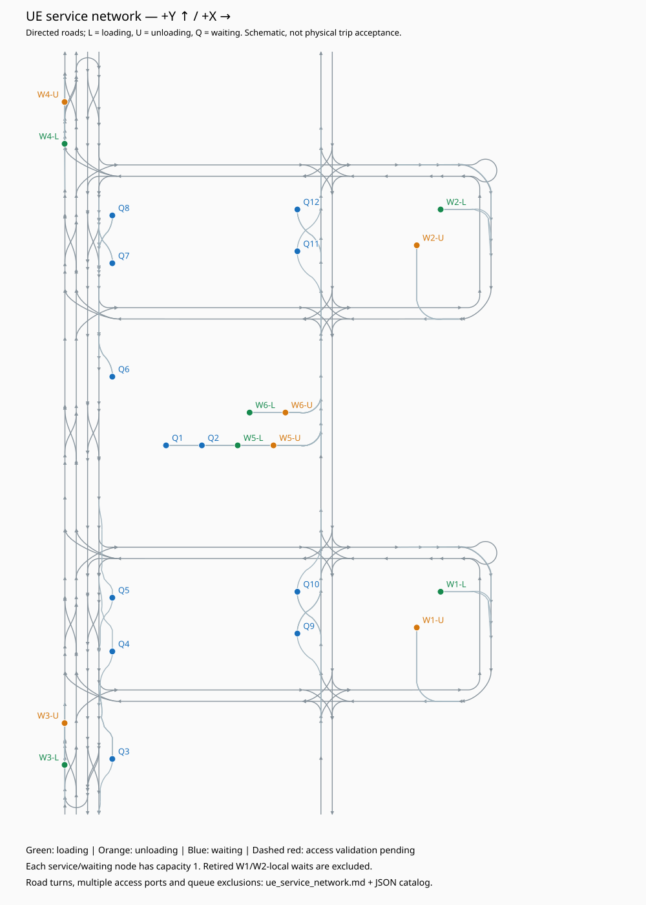

# UE 装卸与等待节点网络

24 个独立业务节点：W1～W6 各有装货、卸货节点，Q1～Q12 为等待节点；弃用的 W1/W2-local 不入图。
道路保留原来的有向车道、左右转许可、变道和末端掉头；入口和出口分别建端口，保留多个可行接入方式。每个节点还记录接入原道路编号、入口/出口朝向及接入位置；端口数量可能包含同一方向的不同接入位置。车辆朝向按 UE +X/+Y 定义，路径坐标统一为后轴坐标。

全部 552 个有序节点对中，552 个有拓扑路径。每对保存入口/出口组合的代表路径、所有可达有向道路集合以及途中等待方案。道路有循环，所有路径无法有限逐条穷举；完整图保存全部道路，走廊集合包含合法绕行，代表路径按距离/速度的静态成本选择。

**局部接入证据不等于整段 UE 运输验收，全园区自动调度仍关闭。** 已通过的接入采用实际测试过的平顺后轴轨迹；其余短边界连接仍是拓扑关系，执行整段路线时需衔接轨迹。静态时间不含加减速、服务和排队。

9 个平顺边界端口与 W3 装货倒车进入、W4 卸货倒车退出、Q9 倒车进入、Q3 倒车退出这 4 个方案均通过 UE 低速验证；按 5 车、3 车、单车分组，见 [接入验收](ue_access_connections_acceptance.md)。默认排除待验证接入后，552 个节点对有路径。仍待验证的倒车序列为 0，边界端口为 0。这表示局部接入缺口已补齐，不表示 552 个节点对逐对完成 UE 运输。



| 节点 | 类型 | 位置 UE m | 道路入口/出口数 | 入位方式 |
|---|---|---|---:|---|
| W1-loading | loading | [28, 124] | 2/2 | reverse |
| W1-unloading | unloading | [20, 112] | 1/2 | forward |
| W2-loading | loading | [28, 252] | 2/2 | reverse |
| W2-unloading | unloading | [20, 240] | 1/2 | forward |
| W3-loading | loading | [-98, 66] | 2/2 | forward, reverse |
| W3-unloading | unloading | [-98, 80] | 3/1 | forward |
| W4-loading | loading | [-98, 274] | 1/3 | forward |
| W4-unloading | unloading | [-98, 288] | 2/2 | forward |
| W5-loading | loading | [-40, 173] | 8/8 | forward, reverse |
| W5-unloading | unloading | [-28, 173] | 8/8 | forward, reverse |
| W6-loading | loading | [-36, 184] | 4/6 | reverse |
| W6-unloading | unloading | [-24, 184] | 4/6 | forward, reverse |
| Q1 | waiting | [-64, 173] | 8/8 | reverse |
| Q2 | waiting | [-52, 173] | 8/8 | forward, reverse |
| Q3 | waiting | [-82, 68] | 1/2 | forward |
| Q4 | waiting | [-82, 104] | 1/1 | forward |
| Q5 | waiting | [-82, 122] | 1/1 | forward |
| Q6 | waiting | [-82, 196] | 1/2 | forward |
| Q7 | waiting | [-82, 234] | 1/2 | forward |
| Q8 | waiting | [-82, 250] | 2/2 | reverse |
| Q9 | waiting | [-20, 110] | 2/3 | forward, reverse |
| Q10 | waiting | [-20, 124] | 2/3 | forward |
| Q11 | waiting | [-20, 238] | 5/2 | forward |
| Q12 | waiting | [-20, 252] | 1/2 | forward |

## 途中排队规则

每个等待位容量为 1。候选等待位必须有有向的“源点→等待位→目的点”路径；每项记录两段具体道路、额外距离、是否属于目的仓库原推荐位、所需预约、必须清空的其他点位以及边界连接是否仍待验证。原仓库推荐位是偏好，不会把其他有合法路线的等待位排除。
若进入等待位会经过目的泊位、扫过其停车包络，或申请目的点作业期间占用的共享通道，则该等待方案不能在目的泊位被占用时直接补充排队，单独标为 `requires_destination_clear`。不能仅按地图距离选择等待位。
Q1 出位需 Q2 清空；Q1/Q2 与 W5 共用通道。Q6～Q8、Q9/Q10、Q11/Q12 进出各有共享预约。W5/W6 作业出口连同局部对向通过区预约，直路上可以并行；现场容量、预约 FIFO 和车尾释放仍由后续调度器执行。道路或装卸通道扫过其他停车包络时，边记录 `must_be_empty_nodes`。

## 数据与查询

- `config/topology/industrialarea_ue_service_network.json`：完整有向道路、端口、装卸/等待节点、许可转移、占用约束、来源校验值。
- `config/planning/ue_service_connectivity.json`：全部有序节点对、端口替代路径、可达道路全集及排队等待方案。
- `ServiceNetwork.route()`：可按首/末接入边、被占用节点和是否允许待验证连接筛选路线；`queue_options()` 给出可达且可继续前往目的点的等待位。

```bash
.venv/bin/python scripts/build_ue_service_network.py
.venv/bin/python scripts/query_ue_service_network.py W5-loading W6-unloading
.venv/bin/python scripts/query_ue_service_network.py W5-loading W3-loading --include-pending
```

```python
from logistics_park.routing.service_network import ServiceNetwork
network = ServiceNetwork('config/topology/industrialarea_ue_service_network.json')
route = network.route('W5-loading', 'W6-unloading', allow_pending_access=False)
queues = network.queue_options('W5-loading', 'W6-unloading')
```

下一步按具体任务筛选路线，先覆盖六仓库代表性运输，再把等待位容量与作业/路口预约接入路径规划；新入口方案仍需补入证据后发布。
