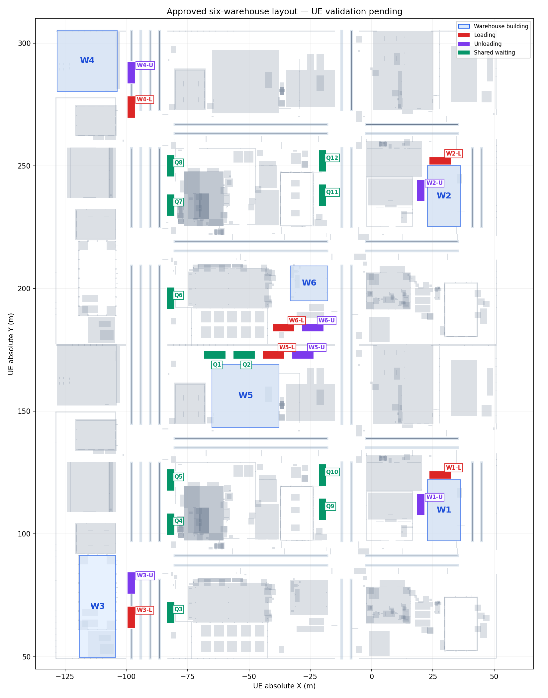

# 六处仓库与装卸区（布局已审批，待 UE 动态验收）

保留原来的 W1、W2；在宽路低 Y 端、高 Y 端分别新增 W3、W4；在中间一排现有建筑中选 W5、W6。每处各有独立的装货位 L 和卸货位 U。W1、W2 的 local waiting 位因阻挡卸货通道，已按用户要求弃用；由 Q9/Q10、Q11/Q12 分别承接等待需求。原 Q1/Q2 保留，现有 Q1–Q12 共 **12 处共享等待位**。宽路两端使用现有路面，无需新建装卸坪。

| 仓库 | 建筑与位置 | 装货 L 中心 X,Y (m) | 卸货 U 中心 X,Y (m) | 等待中心 X,Y (m) |
|---|---|---:|---:|---:|
| W1 | 保留：低 Y 园区右侧低棚厂房 | 28, 124 | 20, 112 | 见等待位分区表 |
| W2 | 保留：高 Y 园区右侧低棚厂房 | 28, 252 | 20, 240 | 见等待位分区表 |
| W3 | 新增：宽路低 Y 端西侧建筑 | -98, 66 | -98, 80 | 见等待位分区表 |
| W4 | 新增：宽路高 Y 端西侧建筑 | -98, 274 | -98, 288 | 见等待位分区表 |
| W5 | 新增：中间建筑排低 Y 侧 | -40, 173 | -28, 173 | 见等待位分区表 |
| W6 | 新增：中间建筑排高 Y 侧 | -36, 184 | -24, 184 | 见等待位分区表 |

坐标是 UE 世界绝对米坐标、停车包络中心；车辆 Actor 生成点需按车体中心与挂厢偏移换算。图中上方是 +Y，不代表当前镜头中的“左/右”。每个静态包络为 9 m × 3.3 m，所有泊位互不重叠。

| 等待分区 | 泊位与中心 X,Y（m） | 建议服务仓库 |
|---|---|---|
| 中央共享 | Q1: -64,173；Q2: -52,173；Q6: -82,196 | W5、W6，满位时跨区调度 |
| 宽路低 Y 路缘 | Q3: -82,68；Q4: -82,104；Q5: -82,122 | W3 |
| 宽路高 Y 路缘 | Q7: -82,234；Q8: -82,250 | W4 |
| 中部道路旁硬化地 | Q9: -20,110；Q10: -20,124 | W1 |
| 中部道路旁硬化地 | Q11: -20,238；Q12: -20,252 | W2 |

Q3–Q8 是宽路**东侧路缘**等待位，车头沿 -Y 方向，贴近南行侧；Q9–Q12 在中部道路西侧空地，车头沿 +Y 方向。与现有 RoadGraph 的最近行驶车道边界比对，Q3–Q8 的静态包络尚有约 0.94 m 净距，Q9–Q12 至少约 4.34 m；这只是静态间距，尚需实车确认车门/货厢扫掠、轮胎接地、路缘进出和行驶车辆侧向净距。验证前它们只是候选容量，不能按已投运泊位调度。共享等待区按先到先服务预约，不能在主车道排队。

W3/W4 的 L、U 设在宽路北行**右车道**（X≈-98 m），贴近路西侧建筑；车辆沿 +Y 方向靠右驶入。装卸时必须预约车道、泊位及端部调头冲突区；相邻直行车道能否绕行，要等完整车身扫掠和侧向净距验证后决定，在此之前按双车道临时管制。路面停车不等于建筑到车厢的装卸通道已确认，实施前还需检查路缘、围栏与货物搬运路径。

W5 选 `SM_Build_197`（低 Y 一侧），W6 选 `SM_Build_169`（高 Y 一侧）；露天泊位在两栋建筑面向中间通道的现有硬化地面。W1/W2 的低棚净高不足以让当前挂厢驶入，车辆只在建筑外露天装卸。

当前 UE PIE 场景的只读地面射线与静态包络检测显示：12 个装卸位、12 个共享等待位均通过；原始记录见 `runs/ue_scene/station_siting/` 下五个 `*_clearance.json` 文件。这项检查不覆盖动态扫掠、货物搬运空间、入口/出口和道路交通冲突。审批后先实车验证，再将仓库拓扑、泊位预约、装卸时间与任务状态机接入正式仿真。

用户已批准该布局。坐标进入 UE 验证阶段；未经进出路径和整车动态验收的点位仍不可用于自动调度。机器可读配置：`config/planning/ue_station_proposal.json`。
