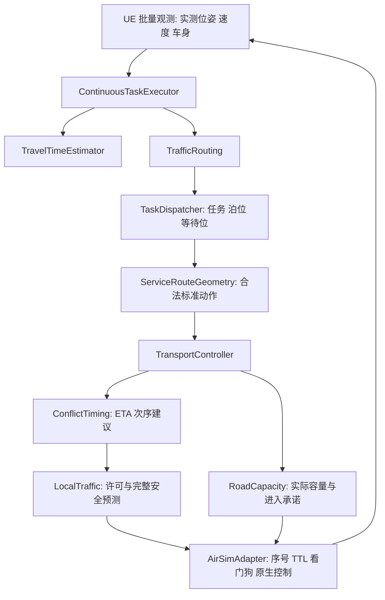
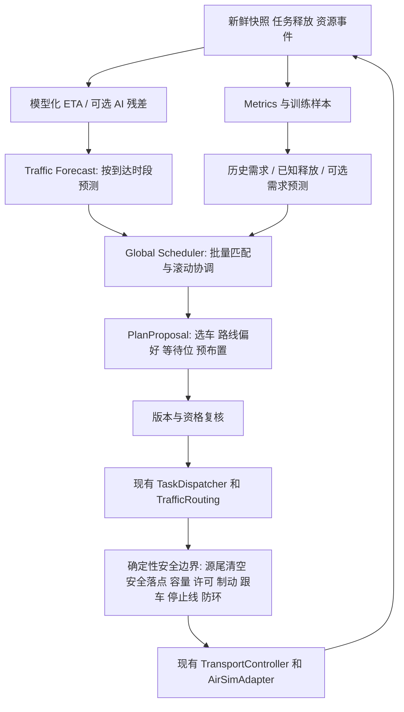
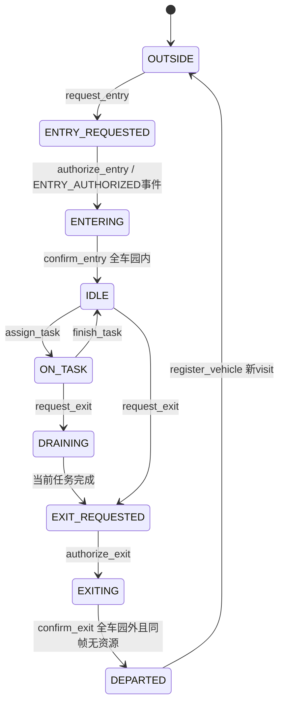
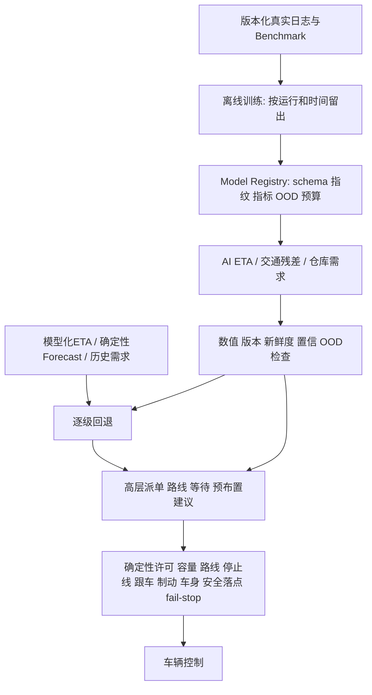

# 物流园区调度算法优化方案

更新时间：2026-10-05。本文以当前真实代码、round47 v23 配置与完整验收为基线，设计下一阶段可分步实施的优化。

**本文只提出方案；没有修改当前核心算法、配置、地图、测试或验收文件，也没有训练模型或重新运行 UE。** 已实现能力、当前证据、建议新增能力和量化目标分别标明，目标不代表已取得收益。

## 目录

1. [文档目标](#1-文档目标)
2. [当前系统能力与实现核对](#2-当前系统能力与实现核对)
3. [当前主要瓶颈与日志证据](#3-当前主要瓶颈与日志证据)
4. [总体优化架构](#4-总体优化架构)
5. [Benchmark 与指标体系](#5-benchmark-与指标体系)
6. [ETA V2](#6-eta-v2)
7. [任务派单 V2](#7-任务派单-v2)
8. [Traffic Forecast](#8-traffic-forecast)
9. [Rolling Horizon Global Scheduler](#9-rolling-horizon-global-scheduler)
10. [等待区与空闲车辆预布置](#10-等待区与空闲车辆预布置)
11. [动态车辆入园与离园](#11-动态车辆入园与离园)
12. [故障与异常恢复](#12-故障与异常恢复)
13. [AI 辅助调度架构](#13-ai-辅助调度架构)
14. [其他潜在优化方向](#14-其他潜在优化方向)
15. [分阶段实施路线](#15-分阶段实施路线)
16. [实验设计与通过门槛](#16-实验设计与通过门槛)
17. [文件与模块修改规划](#17-文件与模块修改规划)
18. [最终推荐路线](#18-最终推荐路线)

## 1. 文档目标

下一阶段从当前安全闭环升级到高效率、高吞吐、可预测、动态运行，再逐步引入数据驱动的辅助预测。核心策略是提高时间估计与系统级选择质量，减少不必要的道路等待、长绕路和资源竞争，复用现有确定性安全链。

本文覆盖八个方向，均按“当前问题、价值、目标、方案、模块、输入输出、集成、安全边界、步骤、测试、验收、风险、回退”十三项展开。近期采用模型化预测、增强启发式及批量匹配；完整 MILP、学习型全局策略和大规模扩展列为有条件的后续研究。

依据优先级：真实代码与当前配置 > 同指纹完整运行结果 > 最新说明文档 > README 历史记录。数值来自保留的 v23 原始资料；统计方法见第 3 章及附录。官方算法文档只用于工具选型，不代替本项目可执行性验证。

## 2. 当前系统能力与实现核对

### 2.1 实际使用链路

当前配置为 [industrialarea_ue_fleet16_round47_proactive_full_v23.json](config/runtime/industrialarea_ue_fleet16_round47_proactive_full_v23.json)，服务图和执行几何分别为 [internal_waiting_network.json](config/topology/industrialarea_ue_internal_waiting_network.json) 与 [internal_waiting_transport.json](config/topology/industrialarea_ue_internal_waiting_transport.json)。



| 已有能力 | 真实入口与行为 | 边界 |
| --- | --- | --- |
| 完整运输任务 | `TaskDispatcher.tick()`、`arrived()`，装货后继续卸货，卸货才 COMPLETE | 每车同时一个任务，逐任务贪心派单 |
| 合法路径 | `ServiceNetwork.route()`，在边转移图搜索，校验禁边、端口、占用、空节点要求 | 不是节点直线导航；目标忙的 future 路由仍受后续准入检查 |
| 拥堵代价 | `TrafficRouting.observe()`、`costs_for()`，0.5 s 观测、约 30 s 路线需求 | 当前没有按到达时段的道路占用曲线 |
| ETA | `TravelTimeEstimator.observe()`、`arrival_profile()`、`_admission_eta()` | 当前没有训练模型、置信区间或完整排队预测 |
| 泊位/等待位 | `promote_approaches()`、`_waiting_options()`，意向/近端许可/实体位置分开 | 15 s 近端窗口，等待承诺保持与出位依赖 |
| 出发与出口 | `_checked_issue()`、`safe_landing()`、`occupied_exit_sweeps()` | 真实车尾清空才调用 `departed()` |
| 局部交通 | `LocalTraffic.claim_passage()`、`regulate()`，特殊动作、完整制动、容量、防环 | 返回布尔许可，时间窗是建议，不是硬全局日程 |
| 交通与跟踪 | `TransportController.tick()`，跟车、停止线、换档、轨迹与车身检查 | 路线切片/曲率及物理响应均影响实际时间 |
| 动态生命周期 | `FleetRegistry`、`GatePermit`、`DynamicFleetBackend` 协议 | 逻辑接口存在，动态 UE 挂接、门端行驶与离场执行未闭环 |
| 通信保护 | `AirSimAdapter.read_states()`、`fail_stop()`、`check_deadlines()` | 固定配置车队；错误锁存后不允许普通新指令自动复驶 |

当前 6 个仓库、12 个装卸节点、20 个策略可选等待位、16 辆初始车、32 个任务。Q3 的相关边 `access_133/access_134/access_167` 禁用；Q26/Q28 不参与等待位选择。20 个单点可选位置不代表它们能全部同时安全停满。

已查看 `tests/test_efficiency_policy.py`、`test_task_dispatch.py`、`test_traffic_routing.py`、`test_maneuver_admission.py`、`test_local_traffic.py`、`test_fleet_lifecycle.py`、`test_continuous_execution.py`、`test_airsim_adapter.py` 等测试，复用其真实边界而非重新设计安全体系。当前存在 52 个 `test_*.py` 文件；文档记录的“513 项 PASS”是既有验收结论，本次未重新执行测试，文件数量不等于测试用例数量。

### 2.2 文档与实现差异

| 描述位置/建议 | 核对结果 | 设计处理 |
| --- | --- | --- |
| README 安装章节“最近 214 项测试”、模块章节将 Conflict Zone/动态路由列为未来 | 混有早期记录；README 顶部和 v23 说明记录 513 项及当前能力；真实代码已有拥堵路由和冲突 ETA | 不以旧章节判断当前功能缺失；后续实现再同步维护 |
| README 历史“当前基线”提到 FIFO/共享通道主导 | v23 `local_traffic=true` 时局部主要由 `LocalTraffic` 执行；天花板/FIFO 释放序号方案未启用 | 继续 ETA、实际前车与已进入保护，不恢复已撤销策略 |
| 提示中的 `ENTRY_AUTHORIZED` 状态 | `FleetPhase` 无此枚举；`authorize_entry()` 记录同名事件，并直接进入 ENTERING | 沿用真实枚举，事件不是新增状态 |
| 提示中的车辆 FAILED、任务重派 | `FleetPhase` 没有 FAILED；`WorkStatus` 只有 PENDING/ACTIVE/COMPLETE，也没有故障转移/载货交接协议 | 新增正交健康状态和故障任务状态，保留货物与实体资源 |
| “已经有 attach/detach” | `DynamicFleetBackend` 仅 Protocol；`ContinuousTaskExecutor.attach()` 只接受已确认节点的停稳车，无正式 detach | 新增门端执行及适配器动态成员协议，不能只修改 `vehicle_ids` |
| “出园只需资源快照为空” | `confirm_exit()` 还要求 EXITING、全车园外、无任务、`resources_observed_at == now` | 同调度时刻确认，不用旧空集合 |
| “错误恢复后重新注册” | `register_vehicle()` 只接受新车或 DEPARTED 后同车再来；在园故障车不能重复注册 | 通信会话重建用新连接世代，真实再入园才换 visit_id |
| “当前 TTL/观测时效取类默认” | v23 运行器覆盖为 TTL 2 s、状态时效 5 s；观察器另有时效，不能混为一项 | 记录有效配置，不扩大任何超时以隐藏故障 |

本次核对 `scripts/continuous_run_sources.algorithm_fingerprints()` 的 32 个算法文件与 v23 UE 报告一致。说明当前分析确实对应保留的 PASS 版本；新增能力必须更新这份指纹清单。

## 3. 当前主要瓶颈与日志证据


### 3.1 已有证据与统计口径

本次读取的主要证据：

- [UE 完整验收](runs/fleet16_round47_proactive_full_v23/physical_acceptance.json)。
- [轻量完整验收](runs/fleet16_round47_proactive_full_v23/lightweight_acceptance.json)。
- [UE 控制诊断快照](runs/fleet16_round47_proactive_full_v23/physical_control_diagnostics.jsonl)。
- [最新运行配置](config/runtime/industrialarea_ue_fleet16_round47_proactive_full_v23.json)。
- [round47 故障与修复记录](docs/round47_proactive_admission_diagnosis.md)。

| 指标 | 轻量基线 | UE 基线 | 解读 |
| --- | ---: | ---: | --- |
| 完整任务与停车 | 32/32、16 车停车 | 32/32、16 车停车 | 当前可靠性起点 |
| 最后一项运输完成 | 1124.90 s | 1456.26 s | 按最后一个 `TRANSPORT_COMPLETE.time` 计算 |
| 全部停车完成 | 1286.00 s | 1654.79 s | 验收报告中的整轮耗时 |
| 最后运输完成后的停车尾段 | 161.10 s | 198.53 s | 两个完成时刻之差 |
| 报告吞吐率，含最终停车 | — | 69.62 任务/墙钟小时 | 32×3600/1654.79，是固定批次指标 |
| 任务从派单到完成的平均/中位时间 | 未重新统计 | 540.65 / 537.16 s | 不包含尚未派单的等待 |
| 最长派单后任务周期 | 未重新统计 | 826.75 s | 应继续分析长尾任务 |
| 报告平均/最大控制周期 | — | 94.17 / 553.40 ms | 包含运行器循环开销，不等于调度计算耗时 |
| 碰撞、车身障碍接触、无许可进入、容量违规 | 已有验收通过 | 均为 0 | 新方案必须保留 |

当前v23 runner为全部32任务构造默认`release_time=0`，因此本场景完整任务流时间可以直接从完成事件计算：均值 **809.39 s**、中位 **764.44 s**、P95 **1362.30 s**、最大 **1456.26 s**；这里P95采用经验最近秩法。平均待派单时间为 **268.74 s**。这些值与上表的“派单后周期”不同，后续优化必须同时比较，避免通过延后派单掩盖等待。

UE 比轻量整轮多约 28.68% 时间。这一差异同时受物理速度响应、控制周期、实际轨迹和不同交通次序影响，不能全部归因于调度代码慢。末次速度学习日志中的各动作速度比例约为 0.77～0.80，也不能单独用于解释全部差异。

进一步对 1555 条 UE 控制诊断快照做左端点积分：每条快照状态持续时间取下一条的 `t_s` 差值，平均间隔约 1.065 s；只统计 `task_assignments` 中仍承担运输任务的车辆，排除任务完成后的停车移动。得到：

| 诊断统计 | 估算值 | 口径 |
| --- | ---: | --- |
| 任务车辆处于 `MOVING` 的累计时间 | 16107.10 车秒 | 多车时间求和，不能当整轮墙钟时间 |
| 其中实际速度绝对值 <0.08 m/s | 4836.47 车秒 | 约占 `MOVING` 时间 30.03% |
| `WAITING` 状态累计时间 | 765.67 车秒 | 主要为已到等待位的任务车辆 |
| `SERVICING` 状态累计时间 | 324.12 车秒 | 与 64 次、每次约 5 s 的服务量一致 |
| 静止且最终指令 <0.08 m/s，首先在 `local_passage_and_timing` 降至此阈值 | 3564.02 车秒 | 当前最主要的静止阶段归因 |
| 同口径，首先在 `maneuver_clearance` / `destination_hold` 降至阈值 | 326.81 / 326.12 车秒 | 特殊动作或目标准入影响 |
| 同口径，首先在 `final_local_regulation` 降至阈值 | 76.49 车秒 | 最后一级预测直接归零相对较少 |
| 实际静止，但指令绝对值 ≥0.08 m/s | 466.36 车秒 | 需区分起步、原生响应、地面问题等 |

这些是约每秒采样的估算，无法识别全部帧内停走。阶段归因表示“最先将指令降至阈值的阶段”，不是经过证明的根因，也不等于这段等待都可以消除。拒绝记录按帧重复产生，不能用事件条数代替等待时长或独立冲突数。

### 3.2 一个直接影响整轮的实例

最后完成的 `transport-4` 由 Car_7_0 执行，目标为 W5-loading → W1-unloading：

| 时刻 | 事件 |
| ---: | --- |
| 645.71 s | 派单，从 W5-unloading 前往 W5-loading |
| 664.07 s | 到装货位并开始装货 |
| 669.21 s | 装货完成，驶向 Q2 |
| 687.32 s | 在 Q2 停稳 |
| 1173.28 s | 下发从 Q2 前往 W1-unloading 的移动 |
| 1451.25 s | 到卸货位 |
| 1456.26 s | 卸货完成，成为最后一项完成任务 |
| 1654.79 s | 该车到 Q37，整轮停车完成 |

该任务在 Q2 的待发时间为 **485.97 s**，按实际到位 `NODE_ARRIVED` 至下次 `MOVE_REQUESTED` 计算；下发移动不等于已获全部许可或车尾已经清空。期间 W1-unloading 队首依次由 Car_0_1、Car_0_0、Car_5_0 等车辆占据；不能简单断言泊位空着却不给它走。从 Q2 出发的路线估计为 156.38 s，实际到站约 277.97 s，说明等待后的长路线及执行延迟也应计入等待位决策。

目前证据足以说明需要完整任务成本和等待位出位成本，但尚不足以保证通过改排这一辆车就能省下 486 s。必须回放当时可用路线、实际前车、共享通道和出口约束，并在完整闭环中验证其他任务受到的影响。

最终停车尾段占 UE 整轮约 **12.00%**。它具有独立优化价值，但其他车的停车可能与运输并行，不能将这个尾段误写成全车累计停车耗时。

### 3.3 代码中的主要局限

| 当前机制 | 已核对的局限 | 对应改进 |
| --- | --- | --- |
| `TaskDispatcher.tick()` 逐任务选最小取货代价车辆 | 先处理的任务消耗车辆选择；未比较载货段与完整完成时间 | 批量匹配和完整任务估计 |
| `service_s × (busy + queue_count)` | 缺少当前服务剩余、离位尾清空、进位、共用通道冲突和候选到达先后 | 泊位/通道事件预测 |
| 任务按 `task_id` 字符串破平局 | 当前同释放时间任务会出现 transport-10 在 transport-2 前；没有业务效率含义 | 批次共同优化，ID 仅作最终确定性破平局 |
| 未来道路需求为 30 s 自由流窗口内的别名集合 | 不区分不同到达时段；普通道路拥堵罚项无法覆盖全部装卸瓶颈 | 按物理资源和时段估计负荷 |
| 等待位按额外距离优先排序 | 与实际出位时间、倒车/换档、队首机会、后续长路线并不总一致 | 以预计完成时间比较直达、原地等和等待位 |
| 泊位 ETA 老化有上限 | 远等待车可能持续被新近车超过；直接扩大老化又可能让远车摘牌 | 可兑现的未来服务机会及发车协调 |
| 局部动作申请逐车进行 | 已有 ETA 与并发支持，但不能整体比较短时多车通行次序 | 只对真实瓶颈小批量排序 |
| 多处 ETA、投影和扫掠检查 | 已有缓存和格网；跨模块重复计算、缓存清空长尾尚未量化 | 分段计时后优化共享快照、增量更新 |

特别注意：当前并非“完全没有缓存”或“所有路口全互斥”。已有 `cache_routes()`、几何缓存、ETA 缓存、扫掠格网、成对冲突缓存、同向跟车与分时例外。优化应扩展其适用范围与一致性，不能以重复实现已有功能作为主要成果。

## 4. 总体优化架构

### 4.1 效率预测与安全执行分层



效率层输出建议，不直接修改 `holders`、`positions`、`passages`、实际 `RoadCapacity.occupants/committed`，不输出油门、制动或转向。调度提交仍通过现有出发预检和控制链；AI 错误建议会被拒绝，但沿参考轨迹的有限安全预测本身也有物理边界，不能据此宣称任何错误下都已证明绝对安全。

### 4.2 统一快照与版本

建议新增只读 `PlanningSnapshot`，含 `observed_at`、`membership_epoch`、`session_epoch`、`route_version`、`topology_epoch`、`resource_epoch`、`traffic_epoch`、任务/车队/真实占位/现有许可/保持线/货物状态。ID 同时使用 `vehicle_id` 与 `visit_id`，通信会话另用 `session_epoch`。

`PlanProposal` 含输入版本、决策理由、代价分项、收益、期限与回退原因。候选计算无副作用，提交串行。路线、车辆访问、门状态或占用发生变化，相关计划和缓存失效；取消软建议不释放实体占用。

软资源状态为 `OBSERVED / ENTERED / EXECUTABLE_NEAR / TENTATIVE`，前两种固定，后三种各受明确撤销规则。未来服务机会存放新软日历，不能伪装为现有泊位 holder。

### 4.3 不同时间尺度

| 层 | 建议初值 | 说明 |
| --- | --- | --- |
| 实测安全/控制 | 每真实 tick | 16 s/0.5 s 车身预测、实际容量、许可与停止线仍执行 |
| 道路观察/预测 | 0.5 s | 更新未来 5/10/20/30/60 s 占用 |
| 简单派单/事件应答 | 重要事件后下一 tick；批量最多 1 s 一次 | 合并同帧释放/到站，不每帧求全局计划 |
| 高层 Rolling Horizon | 每 5 s；重大事件可提前 | 首版预测 90 s，粗尾程至 600 s |
| 空闲车预布置 | 每 30 s 或显著需求变化 | 收益和冷却限制，避免持续绕园巡航 |

在本版此前设计的“1 s 全局协调”中，简单匹配与重型全局搜索没有分开。此次改为 1 s 轻量事件协调、5 s 高层滚动搜索，控制新计算负担。所有周期和预算先影子测量，再由 Benchmark 校准。

## 5. Benchmark 与指标体系

### 5.1 指标定义和统计分母

以场景时钟统一调度事件、快照和释放时间，同时保留墙钟与 UE 时钟；控制/算法耗时用单调墙钟，不跨时钟相减。

| 类别 | 指标 | 计算方法与口径 |
| --- | --- | --- |
| 任务 | transport makespan | 最后 `TRANSPORT_COMPLETE` − 场景开始；单独报告全停车耗时和尾段 |
| 任务 | mean/median/P95/max completion time | `complete_time − release_time`；另报 `complete_time − dispatch_time`，不得忽略待派单等待 |
| 任务 | throughput | 批次任务数/含停车墙钟时间；持续流另报固定稳态窗口真实完成数×3600/窗口秒 |
| 任务 | waiting time | pending、离路等待、道路阻挡、泊位/路口、服务分别记时，主因互斥，其他原因标签可重叠 |
| 车辆 | moving/stopped/blocked | 实测速率与真实位移交叉验证；停稳阈值 0.08 m/s，并区分服务、闲置和任务受阻 |
| 车辆 | empty/loaded distance | 根据真实 cargo 状态积分里程；参考轨迹 s 与实测位移分别记录，改线不能重复累计前缀 |
| 车辆 | utilization | 任务占用时间/可服务在园时间；有效行驶+服务占比另报，避免把堵塞当有效产出 |
| 车辆 | 每车任务数/公平性 | 按 vehicle_id、visit_id 报告；以任务数/可服务小时做 Jain 指数及最小值，任务工作量不同再报运输时间/距离 |
| 交通 | occupancy/utilization | 每个物理别名的实测占用与 committed 分开，再按并集报告；车身跨边仍独立审计 |
| 交通 | congestion duration | 普通道路利用率≥0.8且中位速度<其自由流速度的 0.3 持续≥5 s，作为初始分析定义；不是安全容量规则 |
| 交通 | queue length | 泊位排队意向、近端队列、实体道路队列分别统计；不把远意向当道路车队 |
| 交通 | intersection/berth wait | 第一次近端可执行申请/实际到安全线至获准；同时记录总接近延误和真实服务周期 |
| 交通 | waiting-area usage | 每位实际占用时间、承诺时间、迁移/重访次数、出位受阻及停车尾段 |
| 安全 | 碰撞/障碍/无许可/容量 | 必须均 0；原生地面浅接缝沿用现有判据，不能算作已忽略接触 |
| 预测 | ETA/occupancy error | ETA MAE、P95绝对误差、低估率/区间覆盖；道路按每时域计 MAE及饱和事件漏报 |
| 计算 | 时延/超预算/回退 | 调度自身耗时、观测、审计、发送、日志和循环 P50/P95/P99；不能只报平均循环 |
| 动态/故障 | 事件质量 | 全车入出园时刻、错接单/旧访问事件、资源泄漏、重复完成、故障隔离/重规划延迟 |

Jain 指数 `J=(Σx_i)^2/(n×Σx_i²)`，只包含有效可服务时长>0的车辆；全部 x_i=0 时标为未定义。异构车辆/不同在园时间不能用任务数均分作为硬目标。健康正常、IDLE/ON_TASK/DRAINING 的任务处理时段可定义有效服务暴露，ENTERING/EXITING与故障时间另报。

右删失任务（运行结束仍未完成）必须报告未完成数、已等待年龄和失败率；完成者 P95 与全体可靠性同时呈现。失败运行不得从平均吞吐样本删掉。

### 5.2 数据与实验目录（建议新增）

```text
config/benchmarks/<suite>/<scenario>.json
runs/benchmarks/<algorithm>/<scenario>/<seed>/<repeat>/
  manifest.json              # 时钟、机器、版本、模型/场景/代码指纹、seed
  metrics.json               # 完成/安全/预测/计算汇总
  task_timeline.jsonl        # release/assign/load/unload/finish 等事件
  vehicle_intervals.jsonl    # 状态、主因、位置/里程/可服务时间
  resource_series.jsonl      # 实测和预测按物理别名
  eta_predictions.jsonl      # 在线当时的预测，不能事后重算冒充
  incidents.jsonl            # 故障与恢复事件
  failure_snapshot.*         # 每次失败真实现场；格式需版本化
```

现有 runner 没有这些统一参数/文件，不在本文假装已能运行。建议新增 `scripts/run_benchmarks.py` 与 `scripts/aggregate_benchmarks.py`，先复用现有 setup/执行/审计逻辑，显式新输出目录，禁止覆写 v23。大明细存 JSONL，训练时再导出可选 Parquet；Python 核心仍不强制引入数据科学依赖。

### 5.3 Benchmark A～I

所有场景使用预生成、版本化任务/车辆事件清单；seed 仅控制任务、到达和故障扰动，基线与候选读取完全相同清单。

| 场景 | 首版定义 | 种子/主要判定 |
| --- | --- | --- |
| A 低负载 | 4/8 车、24 个合法运输任务、间隔释放 | 11/23/37/53/71；不能产生多余预布置等待 |
| B 正常负载 | 保留 v23 16车/32任务作为 B0；另设16车/96任务均衡流 | B0确定复现+重复；B1同5 seeds，验证运输及停车 |
| C 高负载 | 16车、正常需求基准到达率的1.25/1.5倍，至少30分钟任务释放 | 同5 seeds；吞吐、队列增长、拒入和不可行原因 |
| D 仓库热点 | 60%任务集中同装货仓库或同卸货仓库，两种子场景 | 同5 seeds；热点延误、其他仓库饥饿 |
| E 随机释放 | 泊松与突发簇两类任务间隔，OD从已验证可达集合采样 | 同5 seeds；任务P95、错误ETA/路由抖动 |
| F 持续流 | 16车、60分钟释放；前5分钟预热，中间统计稳态，最后收尾 | 同5 seeds；稳态吞吐与积压斜率分开 |
| G 动态车队 | 初始10车，120s+2、240s请求3车离园、360s+3，持续任务 | 同5 seeds，成员峰值须受接收/停车容量；轻量和UE均验证 |
| H 道路封闭 | 600s封闭一普通道路别名300s；另测不可绕开的瓶颈 | 同5 seeds；未进入改线、已进入清空、不可行任务保留 |
| I 车辆故障 | 600s注入无货车故障；另测载货故障和观测丢失 | 同5 seeds；货物守恒、障碍保留、无关任务继续 |

首轮到达率不先拍定为每秒固定值：先用 B1/F 逐级测当前稳定吞吐 μ，把 A/B/C 的释放强度设为约0.3/0.7/1.0～1.5×μ，再冻结生成清单。v23 固定批次的69.62任务/小时不能直接充当稳态 μ。

动态、封路和故障目前没有完整支持。为公平比较，分别标注“原始 v23 算法 Baseline”“相同新环境接口+原 v23 决策 Baseline-extended”“优化策略”。接口引入所需改动也要有指纹；原始版本遇故障只会 fail-stop 时，如实报告，不能伪造它支持恢复后再比较。

24车/32/50/100车不直接加在 A～I 首版中：当前20个可选等待位和固定观察/车池构成物理限制，需要先建立真实接收、停车/离园能力；计算规模实验可使用新合成合法地图，标为离线/轻量，不能宣称现园区 UE 已验证。

## 6. ETA V2

### 6.1 当前问题

`TravelTimeEstimator.observe()` 目前只学习动作类别的实测位移/指令速度比例，0.95/0.05平滑、比例截断0.1～1；起步、急变速和异常样本跳过。`blockage_delay()` 对已知受阻增加基准10 s与有限年龄项，尚未预测具体前车、下游排队和源出口何时可执行。

`arrival_profile()` 沿路线限速/曲率/档位积分，冲突默认120 s/0.2 s，泊位查询可用600 s/0.5 s；保持线不能达到时返回无穷。`ContinuousTaskExecutor._admission_eta()` 有约0.5 s缓存。新方案应统一这些时间估计，而不是再加一套相互矛盾的ETA。

### 6.2 为什么值得优化

取货、泊位队首、提前发车、路口排序和等待位评价共同依赖ETA。低估会让多车过早到达并挤占主路；过度保守会产生闲置与长尾。UE与轻量时间差、Q2长等待和未来需求窗口的自由流计算，是需要独立误差评估的直接证据。

### 6.3 优化目标

先输出统一模型化 `EtaEstimate(mean_s,p90_s,reachable,cause,confidence,versions)`，再训练残差模型。首版争取相同留出运行中MAE降低20%、P95绝对误差降低15%，每种动作/负载分桶不明显恶化；建议90%区间覆盖达到85%～95%。这些是拟定门槛，须先测当前基线。

### 6.4 技术方案

**模型化V2：** 将剩余时间拆成互不重复的部分：

```text
ETA = 当前速度/加減速下的剩余标准动作时间
    + 显式换档及当前真实服务剩余
    + 前车与道路队列延误
    + 下游出口/路口冲突等待
    + 泊位进位及预计服务机会等待
    + 经数据校准的执行残差
```

第一项继续使用现有路线积分及实测速率；倒车、调头、右转、服务连接道单独类别。泊位/日历已计入的延误不得再次从拥堵罚项或`blockage_delay()`全额加一遍。前车不动且清空未知，输出 `reachable=false/unknown` 或一组情景，不用10 s固定延迟将实际不可达伪装成可达。

统一两类查询：`admission_boundary_eta` 到真实动态准入线；`destination_arrival_eta` 到终点停稳；任务完成另加服务。服务截止不等于尾清空，源清空仍只对真实已经运动且路径可执行的车辆估计。相同预测版本生成一条`ArrivalProfile`后多点查询；保持线、档位、route/resource/traffic版本变化立即失效。

**数据采集：** 每秒采一条当前实际路线预测，另在发车、保持线变化、换档、改线、到站时采样。复用`physical_trajectory.jsonl`、诊断快照、派单事件与观察速度学习日志；新增明细是为补齐“当时的预测值和版本”，现有日志不能还原所有候选的真实预测。

建议`eta_predictions.jsonl`每条格式如下，字段与单位由`schema_version`固定：

```json
{
  "schema_version": 1,
  "run_id": "benchmark-B1-seed11-baseline-r1",
  "backend": "ue",
  "vehicle_id": "Car_7_0",
  "visit_id": "<actual-visit>",
  "command_id": 83,
  "route_version": 1,
  "prediction_time_s": 1173.28,
  "target_kind": "destination_stopped",
  "target_id": "W1-unloading",
  "heuristic_eta_s": 156.38,
  "reachable": true,
  "features": {"remaining_m": 0, "road_occupancy": 0},
  "label": {"actual_remaining_s": null, "censored": true}
}
```

上面只是字段示例，`features`的0是占位值，不是该车真实测量，不能直接用作训练样本。

| 特征组 | 具体内容 | 取值限制 |
| --- | --- | --- |
| 车辆状态 | 后轴坐标/航向误差、实测速率、位移速率、当前目标、动作/档位、剩余距离 | 只用预测时刻之前的新鲜观测 |
| 路线 | 各类动作剩余距离、转弯/换档数、曲率上限、目的地种类、合法端口 | 不重复计切片数；标准动作合并后统计 |
| 交通 | 物理道路占用、committed、前车间距/速度、下游占用、未来10/30/60 s需求 | 自身负荷排除，预测也不得读未来真实观测 |
| 资源 | 泊位实体持有/服务剩余、队列、动态保持线、LocalTraffic拒绝主因/等待龄 | unknown和缺失值单独编码，不填0表示畅通 |
| 物理/历史 | 各类速度比例、控制周期、观察年龄、后端/地图/算法版本、近期残差 | 不同后端/地图分开校准 |

**Label生成：** 对当前实际执行路线，目标停稳时用`actual_arrival_time − prediction_time`；准入线查询以同版本实测进度首次到线/越线为标签。关联键为`run/visit/command/route_version/target_kind/target_id`，到站事件按每车移动历史连接。任务级标签单独用卸货完成时刻。

路线或目标改变、故障、强制中止且目标未实现时记右删失，保存删失原因与已观测下界，不赋0或任意3600 s。没有实际执行的候选路径无反事实真实label，只作决策分析。若命令ID不变但目标被分流修改，必须切新route_version/episode。上线后标签还受当时调度策略影响，记录算法版本防止混合评价。

**训练选型：** 先学`actual_remaining − deterministic_eta`残差，少样本优先Ridge/线性回归；再比较Random Forest与浅层梯度提升树。XGBoost/LightGBM为可选同类实验，不同时引入全部库；MLP待树模型收益饱和且数据充足再试。树集成的工具能力可参考[scikit-learn官方集成模型说明](https://scikit-learn.org/stable/modules/ensemble.html)，本项目适用性须由留出数据决定。

离线流程为`原始事件→样本校验→按完整run和时间切分→训练集拟合编码/标准化→调参→锁定留出测试→模型登记`。相邻秒样本来自同一条任务，不能逐行随机分到训练和测试；按运行组隔离后采用时间上滚动验证，按后端、负载、地图再留出。防止预处理泄漏的原则见[scikit-learn官方说明](https://scikit-learn.org/stable/common_pitfalls.html)，时间/分组验证参考[官方交叉验证文档](https://scikit-learn.org/stable/modules/cross_validation.html)。

首个AI试验至少争取30个独立运行、300条可标注完整移动、多种负载/种子，不把一轮16车日志中的大量相邻帧当作大量独立场景。此数是启动试验门槛，不保证足够泛化。失败/删失分布另报，模型不能只在成功短任务上选型。

### 6.5 需要修改哪些模块

现有：`scheduling/travel_time.py::TravelTimeEstimator.observe/blockage_delay/snapshot`，`scheduling/conflict_timing.py::arrival_profile/ConflictTiming.prepare`，`runtime/task_execution.py::_admission_eta/_approach_priorities/tick`。建议新增：`scheduling/eta_service.py`统一预测接口，`scripts/build_eta_dataset.py`、`scripts/train_eta_model.py`用于离线数据/训练；训练依赖放可选extra。

### 6.6 输入输出

`新鲜state + execution + route + 保持线/许可/队列 + 历史校准 → 模型化积分/可选残差 → 有限或unknown的ETA、区间、原因、版本、模型来源`。训练输出模型文件、特征schema、数据/代码指纹、留出指标和推理预算。

### 6.7 与当前系统集成

`TravelTimeEstimator`继续提供速度比例，委托统一ETA服务；Dispatcher用于派单/等待评分，Traffic Forecast用沿途进入/离开查询，ConflictTiming用冲突点查询。`RoadCapacity`只提供真实状态，`LocalTraffic`和`TransportController`的制动预测不使用AI的均值替代安全时域或动作许可。

### 6.8 安全边界

AI输出是效率建议；NaN/负数、时间错序、schema/指纹不匹配、观察过期或分布外都拒绝。基础模型判断受真实保持线阻挡不可达时，AI无权改成有限到达。源位不按预测释放；许可继续实测批准。建议对有效AI残差先限制在`±min(30 s,0.3×基础有限ETA)`内并受物理时间下界约束，该限制为稳定性措施，不是安全证明。

### 6.9 实现步骤

先收集“原模型预测与实测”误差；再统一ETA查询与缺失状态；接入前车/真实资源延误去重；模型化V2影子运行；离线训练残差模型；通过留出与推理预算后小范围用于派单排序，再评估其他效率入口。

### 6.10 测试方法

复用`test_efficiency_policy.py`中的稳定速度样本、unknown阻挡、动态安全线和源位提前发车回归。增加同状态多点一致、缓存失效、换档/倒车、目标变更label切分、同run不跨数据集、NaN/OOD回退。用相同完整运行做模型化和AI消融；影子更准不等于实际吞吐已改善。

### 6.11 验收指标

模型化V2达到6.3误差目标且闭环运输/安全不恶化；AI须进一步相对V2 MAE降低≥10%、长尾和低估率不恶化，单批16车推理P95建议≤5 ms。故障样本回退率、OOD覆盖和推理超时均报告，安全计数继续为0。

### 6.12 风险

数据相关性、策略反馈、UE/轻量域差异、运行版本混合、等待原因重复计费、长尾样本不足及缓存导致旧安全线被复用。按动作/负载留出，保留unknown与删失，模型建议先影子，限制在线用途。

### 6.13 回退机制

`AI残差 → 模型化V2 → 原类别校准+arrival_profile`逐级回退。基础观测本身无效则进入现有fail-stop，不能通过回退ETA继续行车。模型切换不修改现有路线、许可或源位占用。

## 7. 任务派单 V2

### 7.1 当前问题

`TaskDispatcher.tick()`逐个处理`(-priority,release_time,task_id)`任务，只从可用且有真实节点、无在途移动的车选择取货路线时间+5 s简化队列成本。目标相同的队列项对很多候选几乎相同，不能充分区分完整任务适合度。ID字符串导致10先于2，不是业务FIFO。

### 7.2 为什么值得优化

先处理的任务占用好车，后续任务可能长空驶；只看装货不看卸货/源出口，会把车送进热点且拖慢整批完成。v23各车完成1～3单是在线分配结果，不应强制每车两单。

### 7.3 优化目标

V1提高完整任务估计；V2批量匹配降低机会成本；V3预测即将空闲车辆，但实际接单仍仅限真实IDLE。固定16车场景先争取运输中位makespan降低10%、流时间P95不恶化，空驶距离降低目标另由基线校准。

### 7.4 技术方案

**V1增强启发式：** 每个候选计算`F(v,j,p)`，包括取货到动态准入线、装货进位/服务、可执行源清空等待、载货段、卸货进位/服务。泊位日历不存在时先用真实服务剩余、队首ETA及出口可执行性做明确有界近似，unknown不伪装成空闲。

```text
cost(v,j,p) = F(v,j,p) - now
            + 0.15 × empty_distance / 8 m/s
            + 0.20 × 对其他已规划车新增延误
            + bounded_fairness_penalty
            + plan_change_penalty
            - bounded_finish_position_value
```

所有项统一为秒；道路拥堵/泊位等待已在F里，不再重复相加。公平项首版在同优先级、完成成本接近时使用，最大10 s；完成位置价值由已释放/历史需求下“下一单取货ETA减少”计算，最大15 s，低置信度取0。任务显式priority按原语义分层，不靠数值权重让距离覆盖高优先级。

**V2批量：** 构造至多64任务、所有真实可用车辆的矩形成本矩阵，每对最多3条合法候选。不可行对无连边；未派任务保留PENDING与年龄，虚拟延后列/行需显式延后成本，不能用极大数当可执行路线。Hungarian适合固定加性一车一单；最小费用匹配/流便于稀疏可行边与容量约束。OR-Tools提供专门线性分配及通用求解器，但它不是Hungarian的同义词，选型依据见[官方分配说明](https://developers.google.com/optimization/assignment)及[线性分配求解器](https://developers.google.com/optimization/assignment/linear_assignment)。

同泊位多任务的代价非加性：先固定日历匹配，再将整批插入临时日历重评，最多3次交换/重评分。不能每一车都预测自己下一位服务。比较整批平均流时间、makespan、空驶、对其他任务外部影响；未选任务的等待与长龄保留候选也纳入，避免推迟难任务得到低分。

**V3滚动：** 即将完成的ON_TASK车进入未来可用时间情景，仅是下一任务软候选；任务实际COMPLETE并返回IDLE后才`assign_task()`。已载货/ACTIVE任务不随每轮重算换车；固定已释放业务任务，未来release只用于明确声明的预见模式，不提前完成/派单。

### 7.5 需要修改哪些模块

现有`task_dispatch.py::tick/_route/_destination_queue/promote_approaches`、`fleet_lifecycle.py::available_vehicle_ids/assign_task/finish_task`、`traffic_routing.py::costs_for`。建议新增`scheduling/batch_dispatch.py`。相同功能先在现有候选选择分支接入，不复制一套完整任务状态机。

### 7.6 输入输出

`已释放任务 + IDLE真实停稳车辆 + 合法候选路径 + ETA/资源预测 + 公平暴露时长 → 分层匹配/整批重评 → 新assignment建议、预计完成时刻、成本分项、未派原因`。

### 7.7 与当前系统集成

Executor更新实际到站/源清空后构建快照，Dispatcher接收匹配建议并串行调用现有FleetRegistry；实际`DispatchMove`仍走`_checked_issue()`及标准几何。TrafficRouting提供合法候选成本，TravelTimeEstimator/ETA服务提供时间，RoadCapacity/LocalTraffic/Controller保留最终决定。

### 7.8 安全边界

不分配ENTERING、DRAINING、EXITING、不新鲜或没有位置的车辆；一车一当前任务，访问ID核对。批次提交后状态变化使余下方案失效时重算，不继续盲提交。源车需腾空仍沿用v23源需求策略，不能为更好下一单长占泊位。

### 7.9 实现步骤

先影子导出V1成本；启用V1单任务决策；实现小矩阵可行匹配与确定性破平局；加入共同泊位日历重评；再接即将完成车的软建议。每步独立开关及消融。

### 7.10 测试方法

复用`test_task_dispatch.py`优先级/释放/无位置/重复任务/DRAINING测试。新增两车两任务贪心反例、部分不可达矩阵、同泊位排队、任务年龄、完整成本与位置价值、同帧资格变化和匹配超时。比较A～F；单批cost减少须进一步从头闭环验证。

### 7.11 验收指标

任何任务不重复派/完成；priority/release/生命周期规则不变；运输与全停车目标见16章。匹配新增计算P95预算20 ms为首版目标，超过预算回退；公平性改善不得以明显增加makespan换取。

### 7.12 风险

不准确的F会放大错误、同目标任务非加性、候选截断、优先级饥饿、未来好位置吸引全部车。跨仓库/同泊位分桶，增益门槛与公平项封顶；持续高优先级超载时低优先级可能等待，必须报积压而非宣称无饥饿。

### 7.13 回退机制

批量求解超时/无效退V1，V1预测不可靠退v23取货贪心。只作用于尚未分配任务；已经ACTIVE的任务、货物、执行移动和真实资源保持。

## 8. Traffic Forecast

### 8.1 当前问题

`TrafficRouting.forecasts`是路线剩余约30 s内的别名集合，并按未来需求0.25权重加罚；它不是未来某时刻的精确occupancy。`RoadCapacity`维护当前occupants与进入committed，未来承诺转成占用时去重；没有按时间离开预测。

### 8.2 为什么值得优化

两车30 s内都经过同一道路不等于同时拥堵；当前空路可能在本车到达时已饱和。静态罚项易引起全车绕向同一路，且装卸通道不能只用普通road边罚项解释。

### 8.3 优化目标

首版确定性预测5/10/20/30/60 s占用和利用率；对unknown出口明确不确定性。先相对“保持当前occupancy不变”的基线争取未来20/30 s MAE降低15%，再证明路由减少道路停止且不增加绕行长尾。

### 8.4 技术方案

为每物理别名a建立按车辆去重的进入/离开区间：当前占用从now起算，已进入动作保留；未来路径按统一ETA查询其入口/出口。当前occupant的“中心投影离开别名”和动作“完整尾清空”分别存，不用同一事件提前释放实体容量。

```text
N_a(t) = Σ_v P(车辆v在时刻t占用别名a)
U_a(t) = N_a(t) / capacity_a
```

首版P来自ETA区间的确定性分配，不是训练模型：确定时段取1，边界区间标范围；unknown离开保持占用上界，输出`expected/min/max/unknown_count`。预测流量守恒，退出后不留永久虚假车；占用与同一车committed合并为并集，软需求不加入RoadCapacity真实committed。

1 s桶覆盖60 s；给Global Scheduler可扩90 s精细及600 s/5 s粗尾程。每0.5 s按变化资源增量刷新；沿途查询`U_a(now+ETA_to_a)`，分配同一物理道路切片成本按长度/占用区间去重。路由成本的非负约束保留。

`ServiceNetwork.route()`当前只接受固定`edge_costs`，不能直接调用“随到达时间变化”的函数而认为Dijkstra仍正确。V1对最多3条合法路径骨架先积分预计到达时刻、查预测曲线，再重评分；无候选走现有搜索。V2才考虑合法边状态加时间标签的搜索，需验证非FIFO代价下的等待处理与预算，不直接改原算法语义。

本批车辆路径共同更新预测需求，最多3轮，上一轮和新需求各0.5混合抑制震荡；混合只用于软需求，不能将实际occupancy/容量打折。下游服务连接道按瓶颈日历预测而不机械套8 m/s道路拥堵公式。

### 8.5 需要修改哪些模块

现有`traffic_routing.py::observe/costs_for/waiting_choice`、`road_capacity.py::update/reserve/release_commitment`（主要只读真实状态）、`travel_time.py`、`task_dispatch.py::_route`。建议新增`scheduling/traffic_forecast.py`与`routing/route_candidates.py`，不将预测表混写实际capacity管理器。

### 8.6 输入输出

`occupants/committed + executions剩余路线 + ETA区间 + 服务/许可/已发移动 → 进入离开事件合并 → 每别名预测占用曲线、置信/unknown、候选路径预测代价`。

### 8.7 与当前系统集成

Executor真实状态更新→RoadCapacity快照和TrafficRouting观测→TravelTimeEstimator/ETA服务→Traffic Forecast→Dispatcher候选重评分。LocalTraffic仍在申请动作和最终预测时查询真实RoadCapacity，不使用预测曲线授予许可。

### 8.8 安全边界

道路关闭/非法转移/实际占位构成禁止条件，不以有限预测罚项代替。故障车或不动源位不能按自由流算离开。相同alias去重但车身跨边与出口空间依然检查。

### 8.9 实现步骤

影子生成曲线并与未来实测对齐；实现守恒与unknown；只用于新派单候选路径评分；再用于合法停稳绕行和等待评分；最后接滚动计划。路线变化、closure与成员变化使相关预测缓存失效。

### 8.10 测试方法

复用`test_traffic_routing.py`自身排除、剩余路线、新command缓存、仓库捷径与等待滞回。新增同车占用/承诺不重复、先离后到、未知清空、切片重复别名、相同时路段不同时占用、批次迭代稳定与封路撤销。

### 8.11 验收指标

预测分时域MAE/饱和漏报下降，流量守恒回归全部通过；路由启用后道路blocked车秒争取降低10%、空驶/等待绕行不增加10%以上，运输P95不恶化。实际安全零违规。

### 8.12 风险

预测与路径选择互相影响、车辆计划未兑现、容量别名和扫掠资源混淆、窗口截断、道路代价不满足原搜索假设。采用路径候选重评、有限迭代、软需求和真实资源分开，超窗口unknown继续保留。

### 8.13 回退机制

过期/超预算/OOD退现有`TrafficRouting.costs_for()`；个别道路预测unknown只停用该段预测收益，实体阻挡保留。已发路线及已进入承诺不因预测失败被抹除。
## 9. Rolling Horizon Global Scheduler

### 9.1 当前问题

当前Executor每tick更新任务、ETA、意向、保持线和局部许可，但没有联合求解未来任务/路线/等待位的小规模全局计划。现有`rolling_resource.py`属于兼容共享资源预约，不等于Global Scheduler；不能因为名字含rolling就宣称已有全局优化器。

### 9.2 为什么值得优化

局部最短取货、最近等待位、单车动作ETA依次作决定，可能共同造成热点、封堵与最后任务长尾。批量匹配解决一轮车辆选择，但不能同时协调其后的服务、通道和发车机会。

### 9.3 优化目标

首版每5 s求一次未来90 s小计划，保留600 s粗尾程，改善整批流时间、makespan与最大等待。计划只给未提交动作建议；任何重算都不换走ACTIVE任务或打断已进入动作。

### 9.4 技术方案

采用“统一快照→生成候选→固定真实承诺→匹配初解→共同软日历重评→有界局部交换→版本复核→提交第一步”。候选仅涉及可用车、即将完成车的未来建议、已释放待派任务、合法路线/等待位及近期瓶颈；90 s外目标仍有尾程成本，防止把长任务推到窗口外获得假收益。

```text
J = mean_predicted_flow_time
  + 0.30 × predicted_transport_span
  + 0.15 × empty_distance / 8 m/s
  + 0.20 × 对既有任务新增延误
  + bounded_max_wait/fairness_cost
  + route/waiting_change_penalty
```

实际前车顺序、ENTERED、不可刹停承诺固定。源尾清空、泊位服务、进入通道和尾退出分别是预测事件；软日历不能预先改实际holder。每冲突簇≤8个候选，束宽16、深度4；同向车队须有出口容量与真实跟车可执行性，无冲突的方向继续并行。

| 方法 | 适合本项目哪部分 | 当前选择 |
| --- | --- | --- |
| Hungarian/最小费用匹配 | 一车一单固定加性成本、车位匹配 | V2首选基础解，无法独立处理复杂时间/资源非加性 |
| 有界交换/束搜索 | 少量近期任务顺序、路径偏好、等待位和瓶颈插入 | Global V1，便于预算/回退及复用当前接口 |
| OR-Tools CP-SAT | 小冲突簇的离散开始时刻、服务前后关系/容量区间 | 后续可选实验，不是直接替代控制器 |
| MILP | 稳定线性/整数模型下的任务/服务机会优化和离线下界比较 | 后续离线研究，不建立完整园区细粒度时空模型 |

OR-Tools是工具集合，MILP是建模形式，Hungarian是算法，三者不是同层级替代项。CP-SAT整数约束与`OPTIMAL/FEASIBLE/UNKNOWN`等状态须正确处理；UNKNOWN不等于得到可执行解。工具细节依据[官方CP-SAT说明](https://developers.google.com/optimization/cp/cp_solver)。本项目只有通过自身版本/合法性复核的可行建议能提交。

首版求解时间软预算20 ms；热点循环拆成可中断小步。若测得难以同步完成，使用只读快照的独立工作进程、200 ms建议有效期初值和5 s周期，过期解弃用；主进程当tick仍走原调度，不等待优化器。200 ms需与实测周期校准，不能认为后台方案永远新鲜。

为等待区远车保留**软服务机会**：Q2→W1原ETA就156.38 s，不能因为超过90 s永久排除。近车能在远车到达前完成且尾清空时可插空；高龄远车的预计机会延期产生罚项，但不占真实远端泊位。实际离路等待发车仍遵守当前队首、实体清空ETA/目标可用、安全落点；第一版不以软日历替代未运动源车的清空证据。

调度器还控制向瓶颈发车的在途负荷：配额来自已验证安全停止点/出口容量，不能拍定每仓库两车。源位需腾空沿现有安全清空规则；staging本就在主路，不能作为长期离路缓冲。记录保持原因与预计重评时刻，不让软计划靠等待标志延长守卫。

### 9.5 需要修改哪些模块

现有`runtime/task_execution.py::tick`、`task_dispatch.py::tick/promote_approaches/_checked_issue`、`local_traffic.py::claim_passage`、`maneuver_admission.py::prospective_cycle`。建议新增`scheduling/global_scheduler.py`、`scheduling/resource_calendar.py`；`ResourceRelationIndex`可同文件组织，不另复制路网。

### 9.6 输入输出

`版本化快照+任务/ETA/未来负荷/需求 → 匹配与有界搜索 → PlanProposal(新派单、路线偏好、等待位、发车/近期次序、预计收益、版本)`。返回求解状态、耗时、置信度与回退理由，不返回油门/制动/转向。

### 9.7 与当前系统集成

Global Scheduler向Dispatcher提供建议，Dispatcher用TrafficRouting合法路径和ETA服务重核；TransportController申请LocalTraffic许可并检查RoadCapacity；`safe_landing`与`regulate`最后约束命令。`access:W1/berth:W1-loading/access_002`显式关联实际经过节点和几何出口，不依赖名称相等。

### 9.8 安全边界

已进入动作、真实源位、车身、制动前缀、停止线、访问生命周期固定。未进入计划改序也须满足可刹停/撤回规则；全局“日历无重叠”不能证明物理安全。不恢复FIFO释放序号、区域天花板、继承或抢占。

### 9.9 实现步骤

先影子比对候选和计划理由；只启用新任务匹配偏好；加入等待位/路线建议；对W1/W5真实瓶颈启用近期次序；最后加入受控发车与即将完成车情景。每一步有开关，计划只提交第一段。

### 9.10 测试方法

同帧第一提交使后续资源版本失效、UNKNOWN解、规划超时、成员变化、窗口外长任务、Q2远车机会、实际前车保护、拟新增环、W3队尾出口和Q29有效后续冲突。所有真实round47 fixtures保留；先局部再完整A～F/G测试。

### 9.11 验收指标

初版相同16车场景运输/全停车中位耗时至少降低10%，成熟版争取15%～20%；任务P95和可靠性不恶化。求解P95≤20 ms为同步目标；预算/过期丢弃比例可观测，控制P99不能因为搜索明显恶化。

### 9.12 风险

时间估计错误、优化器追逐自身预测、软机会造成远车摘牌、窗口末端囤积、计划抖动与额外算力。保留尾程、固定真实前缀、需求混合、收益/变更门槛及版本期限。

### 9.13 回退机制

求解失败/过期退批量匹配或原贪心，关闭新建议输入；既有执行许可保持至真实清空。全局优化没有找到方案不是安全层授权抹掉实体占位的理由。

## 10. 等待区与空闲车辆预布置

### 10.1 当前问题

`_waiting_options()`优先额外距离，`TrafficRouting.waiting_choice()`比较简化停车/出位自由流；当前`park_idle_vehicles`是实际停车，没有历史需求预测和战略区域配额。候选已有容量、承诺、邻位出位依赖、出口和成本检查。

### 10.2 为什么值得优化

近等待位可能出位后单行绕远、倒车/换档多或错过泊位机会。空闲车都停到对未来任务很远的地方，会增加下一批空驶；但频繁预布置也会占路、加能耗并干扰运输。

### 10.3 优化目标

联合比较直达、原位等待、合法Q位、受限绕行；最终停车降低尾段25%的目标单独验证。战略预布置在持续流中争取取货ETA中位降低10%，预布置空驶代价和运输吞吐同时报告。

### 10.4 技术方案

**任务等待位：** 以完整预计任务完成时间评分，计入到Q、停车/换档、等待机会、出位、后续路线及对其他车影响。保留60 m/30 s候选预算、60 s承诺、120 s不重访；持续阻挡且净收益>10 s才换位。针对Q2实例比较后续长路线、其他合法Q位和源位等待出口影响，不能简单禁Q2。

**闲置联合停车：** 对真正无任务的车与合法空Q位做批量匹配，目标为平均到位时间+0.5×最晚到位时间+对运输新增延误。全部目标停放包络联合检查，不能逐个位安全就认为一起停满安全。

**Strategic Repositioning三级需求：** R1按历史仓库释放频率做EWMA，衰减窗口初值300 s；R2使用业务已知未来120 s释放清单，明确声明前瞻权限；R3后续用时间/仓库/过去需求训练预测。随机Benchmark中若提前提供未来清单，是信息增强场景，不能和只看已释放的基线混比。

先按仓库预计装货需求计算待补空闲车数，减当前空闲/即将空闲/已在预布置的有效覆盖量。每仓库覆盖按从真实Q位到合法端口的ETA决定，不用欧式距离；同一车不重复覆盖多个同时发生需求。

```text
reposition_cost(v,q) = ETA(v→q) + 空驶/换档成本
                    + Σ_w normalized_demand_w × ETA(q→w)
                    + 区域供给过剩罚项 + 对运输新增延误
```

容量、邻位依赖、堵主路与源出口影响是不可行约束，不能用小罚项买掉。以“保持原位”作为显式候选；预计120 s需求下的取货总收益至少超过移动成本10 s，30 s重评、60 s战略冷却，并限制每轮最多20%真正空闲车主动移动（向上取整但受资源约束）。该限制不妨碍必须的源位清空和最终停车。

### 10.5 需要修改哪些模块

现有`task_dispatch.py::_waiting_options/_issue/arrived/tick`、`efficiency_policy.py`、`traffic_routing.py::waiting_choice`、`runtime/queue_clearance.py`、`runtime/safe_landing.py`。建议新增`scheduling/parking_assignment.py`、`scheduling/demand_forecast.py`、`scheduling/repositioning.py`。

### 10.6 输入输出

`空闲资格+当前位置+合法Q位+需求分布+未来供给+ETA/出口约束 → 匹配/收益评价 → 等待目标或REPOSITION建议、区域目标、预计净收益、不可行原因`。

### 10.7 与当前系统集成

已释放任务派单优先；预布置复用现有`DispatchMove(purpose='REPOSITION')`和真实出位/到站。当前这类移动会用FleetRegistry登记移动任务并在`arrived()`结束，因此车在预布置中不可同时接运输任务。未来抢单只可在已验证停稳节点衔接，不能把在途停车车当IDLE。

### 10.8 安全边界

所有移动仍走标准边、出发safe landing、LocalTraffic与容量；目标承诺不可借位、不能侵入源出口。DRAINING/退出车不做战略预布置。满园或不可达时保持安全位置，当前20位不支持无条件24车停车。

### 10.9 实现步骤

先改等待位完整评分；再联合最终停车；采集需求与供给历史，影子R1；启用小比例R1预布置；最后R2已知release与R3学习型预测分别消融。

### 10.10 测试方法

近Q位长出路、单行/倒车、Q1/Q2邻位依赖、组合停车封出口、历史无数据、需求突然转移、预布置途中新单/离园申请和收益不足保持原位。A场景验证不开无效空驶，D/F验证热点供给。

### 10.11 验收指标

停车尾段≤148.90 s是v23参考目标；预布置取货ETA中位下降≥10%、总空驶增长不超过5%且稳态吞吐不下降。使用已知未来释放得到的收益单独报告；所有安全与真实停车条件保持。

### 10.12 风险

需求预测错、区域扎堆、预布置抢路、收益只体现在短任务、无限Q→Q。采用历史先验、覆盖去重、限额/冷却、任务优先、显式保持候选。

### 10.13 回退机制

需求不可用退原闲置停车，战略模块关闭不取消已经执行的移动；待其安全到站/合法节点再使用原规则。任务等待评分出错退原额外距离排序，实际占位和货物保持。

## 11. 动态车辆入园与离园

### 11.1 当前问题

`FleetRegistry`状态和visit保护已实现；`DynamicFleetBackend`尚为协议，`AirSimAdapter`的固定`config.vehicle_ids`关联sequences/deadlines/API/档位/观测，批量快照要求完整固定集合。Executor要求`set(states)==set(controller.executions)`；现有`attach()`只允许已确认节点位置的停稳车辆。

`TaskDispatcher._issue/arrived()`面向运输与REPOSITION，不能将ENTRY/EXIT假作装卸任务；`release_for_exit()`要求EXITING且无assignments/moves。当前runner固定pool，未提供门端标准路径、门边界和动态set的原子切换。

### 11.2 为什么值得优化

真实运营需要持续增减车、重复访问和排空离园。仅逻辑注册不能检验观察、容量、许可、API与实体边界能否正确跨模块更新；固定16车PASS对此没有证明。

### 11.3 优化目标

实现从实际园外等待点入园、确认全车园内后接单、排空当前任务、真实驶出、资源同帧清空、detach及重复入园的闭环。Benchmark G按10→新增→退出→再新增持续服务，成员变化不造成错接单、丢车身或资源泄漏。

### 11.4 技术方案

沿用真实FleetPhase，不新增不必要的ENTRY_AUTHORIZED枚举：



**门端配置：** 建议新增门外等待、门内交接、门外清空节点、全车边界polygon/有向线及合法标准入口/出口边。坐标从现有UE路网实际勘验产生，不把仓库当门，不虚构当前已存在这些节点。进出共享通道采用同一物理alias和实际容量；接收容量同时考虑下游道路、安全等候/停车组合和故障封堵。

**入园：** register→request_entry→后端确认园外Actor身份/停止与新鲜状态→prepare_attach→门端预约/出口检查→authorize_entry→原子加入门端执行与观察/控制集合→沿标准入口行驶→全车越界且在门内交接节点真实停稳→confirm_entry→place_vehicle/任务派单。园外准备阶段车辆仍是障碍，不通过隐藏Actor制造净空。

**门端执行：** 建议新增`GateMovementExecutor`，管理独立ENTRY/EXIT移动，不写假运输Assignment；复用RouteGeometry、TransportController和LocalTraffic。门外车进入执行集合时安装合法门端路线及观察，不提前调用只接受IDLE车的`TaskDispatcher.place_vehicle()`；到门内节点停稳后再进入真实任务层位置。门节点种类、几何绑定及route终点校验需显式扩展与测试。

**离园：** request_exit立即停止新运输/战略预布置；ON_TASK（含当前REPOSITION登记任务）进入DRAINING，现有finish_task转EXIT_REQUESTED；门端授予出口许可后EXITING，独立门端移动沿源位标准离位继续。真实源尾清空时调用`release_for_exit()`，不能一申请就删除positions/holders。

路口/共享资源/局部许可/道路容量分别根据实测清空释放。全车在门外清空边界且不影响门口后，解除园内道路占用投影，释放已实际清空的门资源，再取`executor.resource_snapshot()`并聚合新增门/门端资源，`set_owned_resources(...,now)`→`confirm_exit(...,now,fully_outside=True)`→commit_detach。把车仍投影到finished的门外临时边会造成永不为空，必须明确“园内占用结束”的实际边界逻辑；不能为让空集合成立先删除Actor或清空所有字典。

**成员事务：** attach/detach采用prepare→validate→commit，提交在tick边界。快照含`membership_epoch`，适配器、observer、controller/executor、watchdog与诊断使用同世代集合。prepare失败回滚未开始的控制接管；已进入车辆失败则安全停住并保留观测和身体，不能回滚成不存在。

API原状态、sequence、deadline、档位、状态缓存和碰撞基线按`vehicle_id/visit_id/session_epoch`初始化/清理。detach只在真实离园完成后停止命令/观察并恢复应恢复的API状态，通常不销毁Actor。迟到旧epoch快照/命令拒绝，不把合法成员变化当缺车，也不放宽同世代完整快照要求。

### 11.5 需要修改哪些模块

现有`fleet_lifecycle.py::FleetRegistry/DynamicFleetBackend/GatePermit`、`task_execution.py::attach/resource_snapshot`、`task_dispatch.py::place_vehicle/release_for_exit`、`airsim.py::open/read_states/_read_snapshot/send/check_deadlines/close`、`body_observer.py::FleetFileObserver`与两类runner固定pool逻辑。建议新增`runtime/gate_execution.py`、`runtime/fleet_membership.py`、`scheduling/gate_admission.py`及已勘验gate配置。

### 11.6 输入输出

`注册/退出请求+visit+新鲜全车边界观测+门端路线/容量+园区接收性 → 门端许可/成员事务/实际行驶 → 生命周期事件、真实位置、资源清空、attach/detach结果`。

### 11.7 与当前系统集成

FleetRegistry只管资格，门端调度管入口/出口机会；TrafficRouting/ETA预估门端负荷；RoadCapacity/LocalTraffic批准实际动作；TransportController执行；Executor汇总资源并把门内停稳车交给Dispatcher。所有入出园车即使不接任务也参加附近车身冲突审计。

### 11.8 安全边界

全车实际进入才IDLE；DRAINING不接新任务；EXITING仍保留实体/许可；退出确认要求同now新鲜空资源与全车园外。重复访问才新visit，普通通信重连不用换visit逃避旧资源。入口无接收位时园外等待，不增加园内拥堵。

### 11.9 实现步骤

逻辑协议及轻量事务→勘验单门/标准动作→单车真实入出→二车门端相交/双向共享→固定园内任务期间增减车→重复入园及API恢复→G多seed UE。暂不加入最优车队数量控制。

### 11.10 测试方法

复用`test_fleet_lifecycle.py`全部资格/同帧资源/旧visit测试和`test_continuous_execution.py`资源聚合。新增prepare失败、不同epoch、入园一半、尾未清空、门资源残留、DRAINING当前任务完成、detach错误时序、重入sequence隔离和门端观测异常。

### 11.11 验收指标

错误接单/旧会话应用/提前资源释放/资源泄漏为0；每个许可入园/离园事件都有全车边界与资源证据；G多轮完整任务持续执行且符合动态完成条件，退出后无命令发送、API恢复正确。拒绝入园/不可达退出单独记录，不伪造完成。

### 11.12 风险

多模块成员集合切换不原子、观察器旧缓存、门外临时边占用循环、未验证门几何、watchdog注册竞态与动态退出任务处理。以世代事务和真实边界替代简单删除车ID。

### 11.13 回退机制

未授权新车可撤销prepare并留园外；在园车/已进入门端动作不能回退为固定名单中不存在。动态后端异常时停止新增入口、保留现成员与观测，按已有fail-stop/安全清空处理；不能以固定16车集合覆盖当前动态实体集合。
## 12. 故障与异常恢复

### 12.1 当前问题

已有碰撞、失效命令、过期/缺车观察、等待环和无进展守卫。`AirSimAdapter.fail_stop()`锁存fault并对所接管车辆制动；当前runner通常记录FAIL后退出，未提供业务恢复状态和在线任务转移。`ServiceNetwork.blocked_edges`是启动约束，运行器`cache_routes()`假设图不变；没有正式动态封路API。

### 12.2 为什么值得优化

故障车仍是实体障碍，任务/货物/许可不会因FAILED标签消失。通过单纯重派或清字典“恢复”会造成重复运输、丢货与非法进入。新能力应隔离不可用资源，让与故障无依赖的交通继续，而不是继续堆全园等待规则。

### 12.3 优化目标

分清故障检测、实体保留、业务暂停、合法绕行和恢复资格。H/I中可绕行、无货可转移的任务能继续；载货或无替代资源任务明确暂停等待实际处理。不承诺物理封堵下所有任务仍能自动完成。

### 12.4 技术方案

新增正交状态，不把不同含义塞进FleetPhase：

| 维度（建议新增） | 状态 | 含义 |
| --- | --- | --- |
| VehicleHealth | HEALTHY / SUSPECT / FAILED / RECOVERING / QUARANTINED | 接单资格与实际故障恢复；FAILED不等于已离园 |
| ObservationHealth | FRESH / DEGRADED / LOST / REVALIDATING | 数据可信度；新建议只能用FRESH |
| RoadAvailability | OPEN / CLOSING / CLOSED / REOPENING | 运行禁入、已进入处理、复开核验 |
| BerthAvailability | AVAILABLE / NO_NEW_ADMISSION / OUT_OF_SERVICE / RECOVERING | 新业务暂停与实体退出分开 |
| TaskRecovery | NORMAL / SUSPENDED / REQUEUE_READY / WAITING_CARGO_HANDOVER | 正交于原任务状态，保存attempt/货物所有权 |

新增`Incident`记录原因、首次时刻、影响车辆/资源、全车观察、尝试次数和当前恢复步骤。运行器返回`PASS / FAIL / SAFE_DEGRADED / INFEASIBLE`等明确结果（建议新增报告状态），SAFE_DEGRADED不是完整任务PASS。

**车辆故障：** 指令要求前进但无真实位移时先区分现有交通阻挡、正在服务/换档和故障证据；不能把正常排队直接标FAILED。确认后停止新接单，保留实际车身、occupants、源位及尚不可撤许可；对受影响路线添加不可进入/绕行约束。不能“道路capacity−1”同时再计故障occupant造成双重扣容量，物理容量与障碍禁入分开。

故障任务处理遵守货物守恒：

- **尚未装货、货物确实仍在仓库：** 核实未产生装货副作用后原attempt终止，logical task进入REQUEUE_READY。原车实体/源资源仍保留；解除其任务资格使用建议新增`abort_task_attempt()`，不得调用`finish_task()`伪造成功。
- **正在装货，货物状态不确定：** SUSPENDED，核验服务事务/货物观察；不能立即重派。
- **已装货、在运输途中：** WAITING_CARGO_HANDOVER，货物仍属于故障车。首版允许维修后原车继续，或经真实卸载/交接形成新的attempt；没有实际交接设备/节点能力就等待外部处理，不凭空复制货物给另一车。
- **正在卸货或完成回调丢失：** 根据持久事件和货物状态做幂等恢复，已完成logical task不会再次进入PENDING。

同logical task任意时刻至多一个可执行attempt，attempt分配的`visit_id`/cargo_version严格核对。拖移故障车如果是外部救援，须保存真实轨迹、位置和全车清空证明，不能用任务中传送作为算法恢复验收。

**临时封路：** 建议新增`block_edge()`和`block_capacity_alias()`（当前无此API），后者映射全部服务/执行切片。有效禁边=静态禁边∪运行封闭，解除运行封闭不恢复原Q3等静态禁边。闭路事件推进topology/resource_epoch，路线/ETA/日历/候选与所有动态缓存失效。

未进入车辆停止使用该资源并在可刹停合法边界重规划；已进入且闭路仅表示禁入时允许按已验证路线安全清空。若道路真正存在新障碍、清空路径也被堵，必须停车保留资源，不能强制已进入者驶过障碍。无合法替代任务保持暂停/不可行，不能以超大有限代价让它继续走禁边。

**泊位暂停：** NO_NEW_ADMISSION先禁止新holder/服务请求，撤回安全可撤的未进入承诺；已有车辆完整进位/服务/离位按实际故障性质处理。若只是装卸设备暂停但出口正常，允许安全退出并将未开始服务任务等待；服务进行中则保留货物事务。任务装卸节点给定，不能自动把W3-loading替换成W4-loading；替代仓库需业务明确提供可替代节点与货物映射。

**通信/观测：** 首版沿用adapter全队fail-stop，短暂丢帧只能在现有有效时效内处理，不能沿无限旧位置继续。长时LOST保留最后已知车身和其完整制动/可能运动区域，冻结可能相交入口；无法证明只影响局部时继续全队停，不声称当前已能单车故障后其余车自动行驶。

恢复采用Supervisor复核：重新获取完整同epoch快照、实测停稳、位置/路线/货物/许可对账、时钟/序号正常后重建连接session，建议至少3个新鲜连续快照且覆盖0.5 s再恢复。重建adapter会话和watchdog状态，保留真实visit与资源；不能直接写`adapter.fault=None`或通过新指令解除锁存。重复注册只用于真实DEPARTED后再入园。

局部继续运行是第二版：需要按车独立fault/控制通道、统一不确定障碍、隔离受影响冲突簇和新恢复测试。恢复不了的故障车辆一直参加实体审计，直到实测离园或外部安全处置。

### 12.5 需要修改哪些模块

现有`airsim.py::fail_stop/read_states/send/check_deadlines`、`fleet_lifecycle.py::available_vehicle_ids`、`task_dispatch.py::tick/arrived/departed`、`service_network.py::route`、`traffic_routing.py::observe`、`transport_control.py::tick`、`fleet_progress.py`与fingerprint/runner。建议新增`scheduling/incidents.py`、`scheduling/resource_availability.py`、`runtime/recovery_supervisor.py`；故障attempt/cargo对账可在incidents与Dispatcher扩展中组织。

### 12.6 输入输出

`故障/封闭/停用事件+新鲜/丢失观测+真实资源+任务/货物attempt → 影响面判断/隔离/重规划/恢复对账 → 禁入集、暂停/可重派任务、合法路线建议、恢复授权或明确不可行`。

### 12.7 与当前系统集成

Incident更新接单资格和有效禁边；TrafficRouting/ETA/Forecast传播不确定性，Dispatcher暂停/重派合法attempt；RoadCapacity和LocalTraffic保留真实故障体；TransportController执行停车/合法改线。Supervisor控制是否允许恢复命令，不让AI预测或Global Scheduler自行解除故障。

### 12.8 安全边界

故障不是资源释放事件；载货不能无交接重派；未知车不能当不存在；道路禁入不能截断不可刹停/已进入动作而制造接触。恢复前真实位置和货物状态必须确定。守卫用于保存故障，不靠调长20/90 s阈值“容忍”错误。

### 12.9 实现步骤

事件和正交状态影子记录→无货故障暂停/幂等attempt→道路/泊位运行禁入→全队停稳后的会话恢复→受影响范围隔离→载货真实交接协议。先单故障，后多故障；没有物理支持的救援流程明确留外部处理。

### 12.10 测试方法

复用`test_airsim_adapter.py`过期命令、冻结时间、部分RPC失败、fault锁存。新增无货/装货中/已载货/卸货中四阶段故障、重复incident与完成回调、禁alias全切片/解封静态禁边保留、已进入清空或真实障碍停车、恢复旧visit拒绝、last-body仍挡路。

### 12.11 验收指标

发现确认事件后下一tick禁止新任务/新进入；可行替代在下次规划周期内提出，实际完成另测。重复logical completion、货物复制/丢失、故障体删除、旧会话命令、容量/许可违规为0；I中独立可行任务可继续，受困任务真实标SUSPENDED/INFEASIBLE。故障隔离/恢复时间先建基线，不能将操作人员处理时间归因算法。

### 12.12 风险

误报故障、货物状态不确定、持久事件不足、旧RPC命令延迟、物理区域不可隔离、封闭与已进入权冲突。要求幂等事件、明确attempt/货物版本、局部安全可证明后才恢复无关交通。

### 12.13 回退机制

恢复条件不足保持fail-stop或SAFE_DEGRADED；关闭新优化器不等于取消故障/closure约束。路由预测失败退原路由但仍应用运行禁边，不能回原固定场景忽略已发生异常。

## 13. AI 辅助调度架构

### 13.1 当前问题

当前没有训练模型、在线模型管理或数据集隔离。速度比例学习是在线统计校准，不是已训练的AI调度器。已有确定性安全能力较完整，当前主要缺口是时间/需求预测及高层效率选择。

### 13.2 为什么值得优化

在运行数据足够后，模型可补偿启发式对复杂拥堵/物理响应的偏差；但固定16车一轮数据不足以学习稳定全局策略。先验证预测准确和闭环收益，比直接从稀疏任务奖励学习车辆控制更可评估。

### 13.3 优化目标

按`统计→ETA残差→交通残差→需求→辅助派单/预布置→学习型高层策略`推进。AI仅输出预测、置信度、候选排序与效率分数，安全执行仍经过现有链。

### 13.4 技术方案



建议Model Registry记录：模型类型/版本、训练数据manifest、feature/schema、地图/后端/算法兼容范围、输出尺度、validation分桶指标、运行预算与回退配置。先离线→shadow→单效率入口限幅→Benchmark闭环→扩大；每步保留原预测作对照，不做无审计在线自动重训/替换。

AI Traffic只预测`真实occupancy − deterministic_forecast`残差或饱和风险，不写RoadCapacity；需求模型预测未来每仓库时间桶到达数，历史统计/R2已知release作基线。训练标签按预测当时未来窗口生成、跨run分离，未来release若非业务已知不能作为特征泄漏。

AI辅助派单/预布置先提供候选评分，仍采用合法匹配和收益门槛；高层策略建议内容可限定`vehicle-task pair/path_candidate_id/waiting_node/not_before`，不允许任意坐标路线或连续控制输出。学习策略即使以后用强化学习，也只在这种受约束动作集合上实验。

### 13.5 需要修改哪些模块

现有`TravelTimeEstimator`、`TrafficRouting`、Dispatcher与Global Scheduler建议入口。建议新增`scheduling/prediction_model.py`做版本/数值/回退封装，`scripts/train_eta_model.py`和后续交通/需求训练脚本（均建议新增），模型artifact目录与可选训练依赖。安全模块不调用LLM/随机模型替代判据。

### 13.6 输入输出

`新鲜版本化数值特征→已登记模型/检查器→ETA区间、未来道路风险、需求计数或合法候选分数`。输出含来源、confidence、inference_ms和fallback_reason；不输出控制命令或真实许可。

### 13.7 与当前系统集成

预测统一走ETA/Forecast/需求接口，Dispatcher及Global Scheduler读取结果；RoadCapacity、LocalTraffic、Controller、safe landing和AirSim watchdog保持确定性行为。AI异常不会阻塞命令循环，最后一份过期模型结果也不能无期限续用。

### 13.8 安全边界

拒绝NaN/∞（除明确unknown）、负时间/负车数、越界候选、旧schema/地图/visit、过期观察。模型不能覆写真实占用、清空状态、入出园资格、已进入动作或fail-stop。所谓“AI负责效率”是权限隔离原则，不是对现实车辆绝对零事故的数学承诺；所有版本仍要UE物理验收。

### 13.9 实现步骤

先完成第6章样本与模型化基线；再训练简单残差；模型登记与失效注入；影子长期观测；先启用派单预测；验证交通/需求模型；最后才探索高层学习候选评分。每模型独立开关、版本和作用范围。

### 13.10 测试方法

损坏模型、过慢推理、异常数值、OOD新地图/新车辆规模、缺特征、负ETA、伪空闲容量、选择禁路/退出车。断言拒绝/回退且安全状态未改变；相同快照下固定版本预测可复现，完整闭环指标和失败均保存。

### 13.11 验收指标

ETA模型门槛见6章；交通预测达到8章目标且闭环不恶化；需求预测相对历史EWMA降低留出MAE≥10%并产生实际净预布置收益才上线。AI任意失效注入时非法建议提交为0、回退及时、正常安全指标为0。

### 13.12 风险

训练分布不覆盖24+车、反馈偏差、模型更新改变调度顺序、shadow误差改善却吞吐变差、推理长尾和缺乏独立运行。先积累多负载数据、运行级留出，更新需新指纹验收，不靠更复杂网络掩盖数据问题。

### 13.13 回退机制

`AI→模型化ETA/确定性Traffic Forecast/历史需求→v23效率规则`。安全链、动态资格和已发生故障约束一直保留；若数据本身不可用继续fail-stop，不能为保持吞吐使用失效预测。
## 14. 其他潜在优化方向

### 14.1 近期与长期取舍

| 方向 | 近期值得做 | 长期条件/限制 |
| --- | --- | --- |
| 公平性/starvation | 同priority任务年龄、可兑现软机会、可服务时长归一公平、最大等待 | 超载高优先级持续到达时不能声称低priority必然获服务 |
| 高峰与热点 | 入口接收、瓶颈在途负荷、软日历、任务积压趋势 | 超过物理服务能力须业务限流/扩资源，调参不能创造容量 |
| 空驶/能耗 | 分空载/载货距离、停走次数、换档/预布置距离作代理指标 | 当前没有电量/燃油/SOC输入，不能称实际能耗优化或给kWh收益 |
| 路由/等待稳定性 | 承诺60 s、不重访120 s、收益门槛与变更次数 | 任意在线轨迹生成需新几何/车辆动力学验证，当前不做 |
| 参数标定 | 在训练/调参Benchmark上标定ETA、需求权重和周期，独立验证 | 不自动调小净距/停线/时域/故障超时；物理参数变化另验 |
| 可解释性 | proposal原因、代价分项、拒绝资源/阻挡者、unknown与回退 | 避免只给总score导致无法复盘 |
| 地图变化 | topology/resource版本和运行禁入、静态禁边保留、缓存失效 | 新标准动作或车身尺寸变化必须重新几何/UE验收 |
| 32/50/100车 | 离线负载/计算扩展实验，测P95与冲突簇规模 | 当前等待位/车池/门端限制先解决；分区只分计算，跨区安全资源不分裂 |
| 仿真到实车 | 统一单位/时钟、观测不确定性、制动/转向响应单独标定 | UE PASS不是实车安全验证，需硬件制动和传感器数据 |
| 数字孪生 | 版本化状态回放、解释反事实候选、保存失败现场 | 分支回放不能冒充原运行从头PASS或直接代替UE证据 |
| 强化学习 | 暂不开发；先预测与确定性批量调度 | 数据充分且基线成熟后只做受约束高层策略，不控制油门转向 |

### 14.2 计算效率专项：独立于策略变化

当前已有格网、ETA/路线/几何缓存以及SAT中心投影，计算优化应先测热点，再消除重复；纯计算版本在同输入上要求原命令、许可、停止线和容量状态等价。


#### 14.2.1 先增加性能分段计时

在运行器与执行器记录：观测读取/车身审计 → 调度与安全落点 → 路线搜索 → ETA → 局部许可 → 最终预测 → 控制发送 → 日志序列化/写入。嵌套阶段分别统计总耗时和自身耗时，防止重复相加。

使用 `perf_counter_ns()` 或等价单调高精度计时；常态记录聚合直方图，详细热点分析在冻结快照和短诊断运行中进行。不得把 94.17 ms 平均循环周期直接当作 Python 算法的时间预算。

首版滚动协调软预算为 20 ms，一轮完整方案评分结束后检查截止时间；更重的搜索必须拆成可中断步骤。超预算只能放弃效率优化建议，不能跳过当帧实际安全预测。是否需要独立工作进程由测量结果决定，首版先避免线程/进程状态一致性成本。

#### 14.2.2 路线搜索与静态缓存

当前 `ServiceNetwork.route()` 在堆和最佳状态中保存完整 `path` 元组，每次扩展都会复制路径。建议：

1. 将静态后继表、所需资源、空节点要求预整理，减少搜索循环内重复构造集合。
2. 保存当前边的最佳代价和父边，目标找到后重建路径。等代价路径保留明确的确定性规则，验证合法性、代价及现有破平局是否一致。
3. 对固定终点的边转移图预计算忽略占用的自由流剩余时间，作为非负动态代价搜索的下界；起终端口限制必须正确纳入。占用只删边、拥堵只加非负代价时该下界仍保守。
4. 将运行器已有 2000 项路线缓存移为明确的共享服务，采用有界 LRU；缓存键覆盖占用、成本、仓库限制、首尾/入边、拓扑版本等约束。
5. 多路径骨架缓存与在线结果缓存分开，不能复用包含旧占用判断的可执行路径。

不能仅按起终点缓存动态结果，也不能通过过度量化拥堵代价改变路线后宣称纯计算等价。需要改变代价近似时单独记为策略实验。

#### 14.2.3 ETA 共享与增量更新

当前泊位 ETA 约 0.5 s 缓存，但冲突预测、源清空和其他查询仍可能重复积分。每辆车每个预测版本只生成一条带检查点的 `ArrivalProfile`，同版本上查询多个位置；需要不同保持线/速度假设的查询分别缓存。

动态键必须包含实际进度、速度、服务剩余、保持线、换档状态、速度模型和路线版本。当前新旧动态安全线变化时立即失效，防止重现“已到安全线但仍取旧准入 ETA”的自锁。

静态速度剖面与换档点可复用；动态制动和受阻状态逐帧更新。对于停稳被挡车辆返回不可达/未知，不能靠缓存倒计时让它自动变成即将到达。

#### 14.2.4 全时域的空间筛选与成对预测复用

当前扫掠已有格网，`overlaps()` 已直接投影中心和半边长计算 SAT；不建议重复改成顶点列表或只靠当前距离判断。

可进一步为最终 `regulate()` 增加全时域粗筛：

1. 用包含整段 16 s 候选运动、实测初始车身和完整制动的保守 AABB/时间桶索引找可能相交车对。
2. 对粗筛候选继续执行现有每个采样点的精确 OBB 检查；特殊动作恢复保留带符号间隙和硬裕度检查。
3. 逐车确定命令后及时更新其索引，后续车辆使用最新已选预测；静止/已完成车辆同样进入索引。
4. 道路容量继续全局按物理资源统计，不能因空间车对被筛掉而漏查共享容量。
5. 在一次不可变快照内复用相同速度、保持线和制动策略的预测，缓存不跨越当帧许可/保持线变化。

粗筛边界应按两车扩张后的完整包络计算。仅用“当前距离 >某阈值”删车对会漏掉 16 s 内汇合的车辆，不采用该做法。

当前成对扫掠缓存超过 512 项或几何缓存超过 128 项会整表清空；改为有界 LRU，并按拓扑/路线版本失效，减少集中冷启动。采样间距、16 s 时域和 0.35 m 常规裕度保持。

#### 14.2.5 日志与物理接口

按同一不可变快照复用观测，不对每个预测候选重复读 UE。现有批量观察保留；是否瓶颈来自逐车 `send()`、车身审计还是 JSON 写入，先分段测量。

详细重复拒绝日志可按状态变化写入并附持续时间/次数，定期保存摘要。采用有界日志队列时普通诊断可汇总，许可提交、源清空、任务完成和故障现场不得丢失。状态审计与命令发送不因日志队列满而停摆。

计算优化首版在离线快照验证完全相同输入下的命令、许可、停止线和容量状态等价。算法排序优化另行做闭环验证，避免两类变化混在一起无法归因。

### 14.3 组合动作与近端速度建议：后续单独实验

W3首个离位动作曾合并约83 m出库/变道/紧邻路口，整体保护具有真实安全原因。不能直接降低13.8 m组合阈值或缩短出口。只有在两动作之间有已验证标准停车姿态、完整制动距离、车身不侵入任何出口、容量与防环成立时，才配置显式可拆分边界；没有空间就继续原组合，靠上游次序提高效率。

当前普通道路采用到停止线等待，避免远端日历龟速。后续近端直行可以试验有可靠清空证据的短时速度建议，目标是减少完全停车；建议只降低原限速、不越未获准入口、不覆盖特殊动作保护，unknown立即退停车。该项及组合拆分均独立开关/回归/UE验证，不列为Phase0～4的先决任务。

## 15. 分阶段实施路线

建议以以下Phase作为后续开发顺序。Phase是未来任务，不是本次已经实施；每阶段都先通过自身回归和固定场景，再进入下一阶段。

| Phase | 交付物与具体开发任务 | 前置/验收关口 |
| --- | --- | --- |
| 0 Benchmark+数据 | 统一scenario schema/事件清单、A～F固定车队场景、metrics/ETA明细、聚合器、分段计时；冻结B0基线 | 复算v23运输1456.26 s、尾段198.53 s、Q2等待485.97 s；不改变算法决策 |
| 1 动态生命周期 | gate勘验、GateMovementExecutor、成员世代事务、adapter/observer/watchdog动态集合、G真实入出园 | 先协议/轻量、单门单车、再多车和UE；不把Protocol当功能完成 |
| 2 ETA V2 | 统一多点查询、动作/物理校准、前车/服务/出口延误、unknown、残差误差表 | 误差门槛与动态安全线/源清空回归；无AI先得到可靠模型化基线 |
| 3 Traffic Forecast | 10/20/30/60 s进入离开曲线、去重/守恒、候选路径分时评分 | 影子预测优于保持occupancy基线，再闭环路由消融 |
| 4 Dispatch V2 | V1完整任务cost、公平/位置价值限幅、V2矩形匹配、同泊位共同重评 | 一车一单、priority/release、DRAINING保护；A～F改善证据 |
| 5 预布置与停车 | 等待完整成本、联合最终停车、需求EWMA、R1少比例战略预布置、R2已知release独立场景 | 冷却/出口/组合停放回归，收益扣除预布置成本 |
| 6 异常恢复 | Incident/availability、无货attempt恢复、封路/泊位暂停、锁存故障对账；I载货守恒 | H/I安全与实体保留；载货交接缺物理支持时保持外部处置 |
| 7 Rolling Horizon | 5 s高层计划、90 s精细/600 s粗尾程、有界搜索/软机会/发车负荷、版本验证 | 不修改已进入动作、预算/过期回退；联合策略闭环目标 |
| 8 AI预测 | 多run数据集、Ridge→树模型选型、model registry、shadow、ETA/交通/需求残差 | 严格运行/时间留出，预测+闭环双门槛，模型失效注入 |
| 9 AI辅助高层 | 候选任务/路径/等待位/预布置评分；学习型全局策略有条件试验 | 成熟确定性基线和足够动态/异常数据；安全层不替换 |

动态生命周期早做是因为它改变快照成员、可用车分母、visit和故障恢复接口；晚做会使已经积累的训练schema和计划缓存反复返工。ETA误差统计从Phase0开始，不必等待动态UE全部完成才整理已有固定车队数据。Gate地图勘验尚未完成时，可先完成Phase1协议设计/轻量验证，同时开展不依赖门端的ETA影子分析，不能将待勘验动态功能虚报完成。

### 15.1 配置初值与独立开关

以下为建议新增配置字段，当前v23 runner尚不认识，不将它们直接写入当前场景：

| 参数/开关 | 初值 | 约束 |
| --- | --- | --- |
| `metrics_enabled / eta_shadow` | 首先启用 | 只计量，原命令不变 |
| `batch_dispatch` | false | V1/V2分开实验 |
| `traffic_forecast / joint_waiting_choice` | false | shadow通过后逐项启用 |
| `strategic_repositioning / joint_idle_parking` | false | 显式保持候选，运输任务优先 |
| `global_scheduler / ai_eta / ai_traffic / ai_demand` | false | 版本和来源单独记录 |
| 轻量批次/高层周期 | 1 / 5 s | 合并事件，安全每tick继续 |
| 日历精细/粗预测窗口 | 90 / 600 s | 1 / 5 s桶，冲突边界连续处理 |
| 候选路线/任务批次 | ≤3 / ≤64 | 无候选退全图，老任务不被永久漏掉 |
| 同批重评/需求混合 | ≤3轮 / 0.5 | 只混软负荷，实际容量不打折 |
| 束宽/深度/每簇候选 | 16 / 4 / 8 | 有界，超预算回原顺序 |
| 同步规划软预算 | 20 ms | 待分段计时校准，不省略安全检查 |
| 预布置周期/冷却/每轮限额 | 30 s / 60 s / 20%空闲车 | 必须源清空不受战略限额阻止 |
| 战略/等待换位净收益 | >10 s | 扣完整移动/换档/干扰成本 |
| 普通效率改线 | >max(5 s,剩余ETA×10%)；间隔20 s | 原停稳/制动前缀/许可规则保持 |

近端泊位15 s、实际源清空到达缓冲3 s、等待60 m/30 s、60 s承诺/120 s不重访、0.35 m常规裕度、16 s/0.5 s安全预测、既有速度上限和进展守卫保持。新参数实验只改效率参数，禁止通过更高跟踪误差/更长失效期限/更小安全间距获取PASS。

## 16. 实验设计与通过门槛

### 16.1 公平对比与消融

原始基线B0保存当前16/32任务、静态禁边、车身尺寸、初始位置、限速、物理子步、world_time_scale=1和轻量dt=0.1。不得通过更少任务、隐藏实体、改变地图或停车完成定义获得效率收益。

建议对照版本：Baseline-v23；Metrics-only；Compute-only；ETA-V2；Forecast-only；Dispatch-V1/V2；Waiting-only；Reposition-only；Rolling组合；AI-shadow/AI-enabled。动态/故障新增环境能力使用Baseline-extended与优化器共享同一后端，完整指纹和改动范围记录。

每个新层先单独启用，再与已有有效层组合；如提升来自停车，只报告停车专项收益，不说运输已提速。公平性、低负荷、高负荷/热点分桶，不能仅列固定场景最快一轮。

### 16.2 重复、随机与统计

轻量先A/B/D小集探索，候选有效后跑A～F全部5个固定seed，再扩G/H/I已支持能力。UE先B0基线/候选各至少3次交替运行，报告中位数、范围及机器/帧率；动态和故障先真实单例验证，再增加多seed代表场景。

聚合以完整run为独立样本，配对相同seed/事件清单/后端；可用运行级bootstrap给区间，不能对每秒日志采样数做伪显著性。5个seed/3次UE只是初始验收量，不能声称任意负载稳定或强统计显著。

F预热/稳态/收尾分开；持续流稳态积压增长则说明供需不稳定，即使期间没碰撞也不能叫高吞吐通过。高于物理能力的C允许明确限流/不可行，但不能隐藏失败和延后任务。H/I载货被物理故障困住时，要求安全退化、货物守恒及可行其他任务进展，不伪造所有任务必然完成。

### 16.3 量化目标

| 项目 | 拟定门槛 | 基线/注意事项 |
| --- | --- | --- |
| 功能/安全 | 完整正常场景任务与必要停车100%；碰撞/障碍/无许可/容量违规均0 | 故障场景用明确恢复/退化契约；不能删除故障车使指标为0 |
| 首版整体效率 | UE transport makespan中位至少−10%，参考≤1310.63 s；全部停车参考≤1489.31 s | 参考v23一次运行，最终应对同批基线多轮中位判断 |
| 成熟协调 | 运输/全停车争取−15%～20%，全停车参考1406.57～1323.83 s | 不是已验证承诺，各子优化收益不可简单相加 |
| 任务体验 | flow-time mean/median/P95/max全部报告，P95不恶化 | 包括PENDING等待，未完成/右删失单独列出 |
| 停车专项 | 尾段争取−25%，参考≤148.90 s | 同时不拖慢运输；不是累计所有停车移动时间 |
| 计算专项 | 同快照纯计算tick P95至少−30%，P99不恶化 | 94.17ms报告均值是循环，不能直接作该门槛分母 |
| ETA/预测 | 第6/8章误差门槛，unknown/OOD/删失比例可见 | 离线更准需再闭环证明收益 |
| 交通/空驶 | road blocked车秒争取−10%；报告empty/loaded/预布置距离 | 不靠低速巡航把stopped变成moving |
| 动态 | 错接单、旧epoch/visit应用、早释放、退出后命令、资源泄漏均0 | 全车边界/同帧空快照/API恢复有证据 |
| 故障 | logical task完成至多一次、货物守恒、故障实体保留 | 只能重派明确无货任务或完成真实交接后的attempt |

所有收益目标先测基线再锁定；功能完成与性能优胜分别评价。安全层有限参考轨迹预测和UE物理验证仍有边界，不把一批零事故写成绝对安全证明。

### 16.4 正确性回归清单

保留`tests/fixtures/round47_ue_shared_access_cycle.json`以及W2旧出口、W3装货期/队尾、动态安全线、对向软裕度、Q29后续冲突fixtures。新增覆盖矩阵：

- ETA多点/缓存版本、物理速率、unknown清空、同run训练隔离与改目标label。
- 匹配不可达对、同泊位排队、原priority/release、DRAINING/旧visit和同帧资源失效。
- Forecast同车占用/承诺去重、别名切片、离开/进入守恒、未来汇合、封路/改线失效。
- 软机会窗口外长任务、实际前车/已进入保护、超预算/UNKNOWN解、出口/队尾与拟等待环。
- 预布置收益不足保持、组合Q位、热点突变、新任务到达时正在REPOSITION不可接单。
- 成员prepare失败、半车入园、旧epoch快照、尾未清空、门资源残留、重复入园API/序号。
- 载货不同故障阶段、重复完成/incident、运行解封不恢复静态禁边、观测恢复资源对账。
- AI坏模型、NaN/负值、推理超时、分布外、不合法路线/车位建议及时拒绝。

### 16.5 场景schema、运行与证据隔离

当前两个continuous runner把`tasks`当作`[loading,unloading]`对，并构造默认release_time=0的TransportWork。虽然类本身支持release/priority，不能只往JSON写这两个字段就假装动态Benchmark已接通。

Phase0建议新增兼容parser：旧双元素对保持原含义；新任务对象显式`task_id/loading_node/unloading_node/release_time/priority`；成员、封路、故障事件另存`events`并由版本化环境处理器执行。尚未实现事件类型必须启动时报unsupported，不能静默忽略。已知未来清单只在显式lookahead模式进入效率层。

创建新的round48/phase实验配置和`output`目录，源码/地图/路网/任务清单/模型/事件处理器加入指纹。以下新路径只是计划示例，当前尚不存在：

```bash
# 后续实际实施时运行；本次文档任务未执行这些验收
.venv/bin/python scripts/check.py

.venv/bin/python scripts/simulate_ue_continuous_tasks.py \
  --scenario config/runtime/industrialarea_ue_fleet16_round48_optimizer_v1.json

/usr/bin/python3 scripts/validate_ue_continuous_tasks.py \
  --scenario config/runtime/industrialarea_ue_fleet16_round48_optimizer_v1.json
```

`check.py`会写既有Phase0～4输出；实施Benchmark时为基线资料先隔离/备份相应输出或显式改新目录，不覆写旧报告。针对性测试与项目检查通过→新目录从头轻量完整PASS→同指纹UE实测；冻结检查点续跑、诊断前缀和影子计划都不能标作新版本完整PASS。

## 17. 文件与模块修改规划

### 17.1 现有模块的准确落点

下列源码路径相对`src/logistics_park/`，其中`scripts/`路径相对项目根目录；函数/类已从当前文件核对；此表为后续修改计划，本次没有实施修改。

| 真实文件 | 真实类/函数 | 后续计划 |
| --- | --- | --- |
| `scheduling/task_dispatch.py` | `TaskDispatcher.tick/_route/_waiting_options/promote_approaches/_checked_issue/arrived/departed/release_for_exit` | 成本/批量建议、联合等待、资格与故障attempt、门端衔接 |
| `scheduling/travel_time.py` | `TravelTimeEstimator.observe/blockage_delay/snapshot` | 保留速率校准，接统一ETA/残差 |
| `scheduling/traffic_routing.py` | `TrafficRouting.observe/costs_for/waiting_choice/may_resume` | 按到达时段候选评分、需求与缓存版本 |
| `scheduling/road_capacity.py` | `RoadCapacity.update/reserve/release_commitment` | 继续真实占用；给预测只读快照，门端成员/清空管理 |
| `scheduling/conflict_timing.py` | `arrival_profile/maneuver_groups/ConflictTiming.prepare` | ETA共享、近端次序建议、保留成对几何 |
| `scheduling/local_traffic.py` | `LocalTraffic.prepare/claim_passage/_forecast/regulate` | 性能复用和合法次序输入，保持安全生命周期 |
| `scheduling/maneuver_admission.py` | `prospective_cycle/entered_special` | 全局建议仍通过已有已进入保护/防环 |
| `scheduling/fleet_lifecycle.py` | `FleetRegistry/GatePermit/DynamicFleetBackend` | 动态协议实现与健康资格，原visit状态保护 |
| `scheduling/wait_dependencies.py` | `wait_snapshot/strongly_connected_cycles` | 指标/影响面/软清空机会，真实依赖不能忽略 |
| `routing/service_network.py` | `ServiceNetwork.route/queue_options` | 静态候选、搜索优化、运行禁边与版本 |
| `runtime/task_execution.py` | `ContinuousTaskExecutor.attach/tick/_admission_eta/_berth_priorities/_approach_priorities/resource_snapshot`、`ServiceRouteGeometry.plan/stationary` | 预测/快照、动态门端接口、资源与缓存一致性 |
| `runtime/safe_landing.py` | `safe_landing/selected_exit_plan/occupied_exit_sweeps/parking_exit_conflicts` | 联合等待/停车继续复用，不放宽安全判据 |
| `runtime/transport_control.py` | `TransportController.tick/continue_route/reroute_stopped/reroute_forward` | 成员事务、建议执行、纯计算优化 |
| `runtime/body_observer.py` | `FleetFileObserver.snapshot/read` | membership_epoch、同帧新鲜成员快照 |
| `adapters/airsim.py` | `AirSimAdapter.open/read_states/_read_snapshot/send/fail_stop/check_deadlines/close` | 挂接摘除、会话世代、故障恢复对账，保留锁存保护 |
| `runtime/fleet_progress.py` | `FleetProgressWatch/LocalProgressWatch/task_progress/local_progress` | 动态场景合法活动与故障证据，不能放宽守卫逃避失败 |
| `scripts/simulate_ue_continuous_tasks.py` | `setup/cache_routes/run` | 新schema、独立Benchmark输出、动态缓存失效 |
| `scripts/validate_ue_continuous_tasks.py` | 当前UE主循环与固定pool/局部诊断 | 动态成员、故障环境、指标及同指纹验收 |
| `scripts/continuous_run_sources.py` | `algorithm_fingerprints` | 所有新增算法/模型/事件来源纳入验收指纹 |

### 17.2 建议新增文件

以下路径当前不存在，均为**建议新增**。根据实际模块大小可合并，避免为了方案给每个小对象另建包。

| 建议新增路径 | 首次Phase | 职责 |
| --- | --- | --- |
| `src/logistics_park/scheduling/dispatch_metrics.py` | 0 | 统一状态时长、主因、任务/资源/计算指标 |
| `scripts/run_benchmarks.py`、`scripts/aggregate_benchmarks.py` | 0 | 事件清单、多seed/重复、完整结果聚合 |
| `config/benchmarks/` | 0 | A～I版本化场景，未支持事件显式拒绝 |
| `src/logistics_park/runtime/gate_execution.py` | 1 | GateMovementExecutor真实门端移动 |
| `src/logistics_park/runtime/fleet_membership.py` | 1 | 原子attach/detach、成员世代、会话管理 |
| `src/logistics_park/scheduling/gate_admission.py` | 1 | 门口许可与园内接收性 |
| `src/logistics_park/scheduling/eta_service.py` | 2 | 统一版本化ETA、多点共享、区间/unknown |
| `scripts/build_eta_dataset.py` | 2 | 当时预测与真实label/删失关联 |
| `src/logistics_park/scheduling/traffic_forecast.py` | 3 | 未来物理别名占用与负荷曲线 |
| `src/logistics_park/routing/route_candidates.py` | 3 | 合法路径骨架、在线复核/分时重评 |
| `src/logistics_park/scheduling/batch_dispatch.py` | 4 | V1成本和V2匹配/整批重評 |
| `src/logistics_park/scheduling/parking_assignment.py` | 5 | 任务等待/闲置联合停车 |
| `src/logistics_park/scheduling/demand_forecast.py`、`repositioning.py` | 5 | 需求统计、供给覆盖与战略移动 |
| `src/logistics_park/scheduling/incidents.py`、`resource_availability.py` | 6 | 故障状态/attempt/cargo对账、运行禁入 |
| `src/logistics_park/runtime/recovery_supervisor.py` | 6 | 停稳/观察/资源/会话复核后恢复 |
| `src/logistics_park/scheduling/global_scheduler.py`、`resource_calendar.py` | 7 | 高层有界搜索、软资源日历/关联 |
| `src/logistics_park/scheduling/prediction_model.py`、`scripts/train_eta_model.py` | 8 | 模型登记/推理/检查/逐级回退和离线训练 |

新测试分别覆盖每Phase业务边界，优先扩展现有真实fixture测试。可选优化/训练依赖以后放`pyproject.toml`可选extra并固定兼容版本；当前标准库轻量执行路径保留。

### 17.3 本次自检记录

已阅读当前方案、README最新/历史章节、v23配置与报表、核心调度/路由/容量/ETA/安全/执行代码及相关测试。特别核查了固定快照集合、source/target租赁、出园同帧资源和adapter锁存行为。

现有算法32项指纹与v23报告一致；写文档前记录了src/config/tests共348个非字节码文件的SHA256，完成后对这些文件及新增文件集合核对。新增接口/状态/文件明确标注建议；Benchmark、模型和动态/故障功能不写成已有PASS。本次未执行会覆写结果的`check.py`/仿真/UE，现有513项结果仅按原记录引用。

附录只读统计代码用于复算本次引用数据；八个方向均提供十三项模板，实施与验收门槛分别列出。模型建议和确定性许可/实际占用权限分开，所有故障回退保留新发生的物理约束。


## 附录：本次统计的复算方法

运行下面的只读代码可复算任务时刻、停车尾段、Q2 等待及快照阶段归因；它不重跑 UE、不修改运行资料。`MOVING` 静止统计使用 0.08 m/s 阈值，属于状态层估算，未按道路种类进一步筛选。

```python
import json
from collections import Counter
from pathlib import Path
import math
import statistics

root = Path("runs/fleet16_round47_proactive_full_v23")
report = json.loads((root / "physical_acceptance.json").read_text())
events = report["dispatch_events"]
completed = [e["time"] for e in events
             if e["event"] == "TRANSPORT_COMPLETE"]
print("last_transport_s", max(completed))
print("parking_tail_s", report["elapsed_s"] - max(completed))
# v23任务对由runner以release_time=0构造；此处专用于该固定基线。
ordered = sorted(completed)
print("flow_mean_s", statistics.mean(ordered))
print("flow_median_s", statistics.median(ordered))
print("flow_p95_s", ordered[math.ceil(0.95 * len(ordered)) - 1])
assigned = [e["time"] for e in events if e["event"] == "TASK_DISPATCHED"]
print("pending_mean_s", statistics.mean(assigned))
q2_arrival = next(e["time"] for e in events
                  if e["event"] == "NODE_ARRIVED"
                  and e.get("task_id") == "transport-4"
                  and e.get("node") == "Q2")
q2_departure = next(e["time"] for e in events
                    if e["event"] == "MOVE_REQUESTED"
                    and e.get("task_id") == "transport-4"
                    and e.get("origin") == "Q2")
print("q2_wait_s", q2_departure - q2_arrival)

states, motion, stages = Counter(), Counter(), Counter()
previous = None
with (root / "physical_control_diagnostics.jsonl").open() as stream:
    for line in stream:
        current = json.loads(line)
        if previous is not None:
            dt = current["t_s"] - previous["t_s"]
            for vehicle, assignment in previous["task_assignments"].items():
                state = assignment["state"]
                states[state] += dt
                if state != "MOVING":
                    continue
                stopped = abs(previous["positions"][vehicle][3]) < 0.08
                motion["stopped" if stopped else "moving"] += dt
                if not stopped:
                    continue
                if abs(previous["commanded_speeds"].get(vehicle, 0)) >= 0.08:
                    stages["nonzero_command_real_stopped"] += dt
                    continue
                for item in previous["control_trace"].get(vehicle, []):
                    if abs(item["target_m_s"]) < 0.08:
                        stages[item["stage"]] += dt
                        break
        previous = current
print("task_state_car_s", dict(states))
print("moving_state_car_s", dict(motion))
print("first_stop_stage_car_s", dict(stages))
```


## 18. 最终推荐路线

### 18.1 当前首先做什么

**首先完成Phase0：Benchmark、Metrics和当时ETA预测的真实数据采集。** 保留当前v23作为稳定对照，拆开运输完成、最终停车、道路等待和计算耗时。现有证据已经揭示约30%的MOVING车秒实际停着、Q2关键任务等待约486 s和近199 s停车尾段，但未建立足够多负载/seed的误差与可靠性分布。没有这些基线，无法判断优化器只是改变交通次序、推迟任务，还是提高真实吞吐。

### 18.2 第二步是什么

**第二步完成动态成员/门端生命周期闭环。** 明确visit/session/membership、全车边界、资源清空和API状态；先单门/单车轻量与UE，再持续任务期间增减车。当前协议已为这一层留出接口，工程缺口在固定观察/控制集合和真实门端执行。它也是之后动态指标、预测schema和故障恢复的基础。

### 18.3 第三步是什么

**第三步做模型化ETA V2，再推进确定性Traffic Forecast和完整任务派单。** 保留现有积分与实测速度校准，优先处理unknown、动态准入线、一致缓存、前车/出口/泊位等待。以真实误差改善支撑时间分桶预测，再做V1完整成本和V2批量匹配，通常比先堆复杂全局求解器更容易验证收益与解释失败。

随后以等待/联合停车和少比例战略预布置减少空驶与尾段；完成可恢复故障/运行封路约束后，再引入有界Rolling Horizon共同协调近期瓶颈和服务机会。

### 18.4 哪些暂时不要做

- 不开发强化学习直接控制油门、制动、转向。当前问题首先是系统级预测、选择和资源等待；直接控制会同时改变跟踪/物理安全链，难以归因且缺少真实异常训练数据。
- 不一次建立全园区细粒度MILP时空调度。先用匹配与小簇有界搜索验证成本/ETA，复杂模型之后只在确有收益的子问题试验。
- 不从单轮v23相邻秒日志训练复杂深度网络后直接上线。先积累完整独立运行、动态与故障数据，处理删失、版本、后端和策略反馈，再做简单预测模型。
- 不让AI覆写真实占用、许可、源位释放、停止线或fail-stop。预测错误由建议校验/回退和现有安全链限制；AI先用于预测，因为标签清楚、可离线评估、能按入口逐步验证闭环收益。
- 不宣称目前园区已经支持32/50/100车。先解决等待位组合容量、动态入口接收、观察/算力及故障隔离，计算扩展与真实物理验收分开。
- 不以降低安全净距、取消车身预测、隐藏故障Actor、任务途中传送或延长失败阈值获取效率PASS。

明确的开发链路为：

```text
当前稳定Baseline v23
        ↓
Benchmark + Metrics + 真实预测/执行数据
        ↓
动态车辆生命周期与成员世代
        ↓
ETA V2（模型化、一致查询、unknown）
        ↓
确定性Traffic Forecast
        ↓
Dispatch V1完整成本 → V2批量匹配
        ↓
等待位完整评分 + 联合停车 + Strategic Repositioning
        ↓
Fault Recovery + 道路/泊位运行可用性
        ↓
小规模有界Rolling Horizon
        ↓
AI ETA / Traffic / Demand Prediction（先shadow）
        ↓
AI-assisted高层调度（确定性安全链始终保留）
```

每次扩展必须同时提供“功能正确、效率改善、失败可解释、可回退”的证据；通过一轮固定场景不是任意负载无死锁或AI已提升吞吐的结论。
